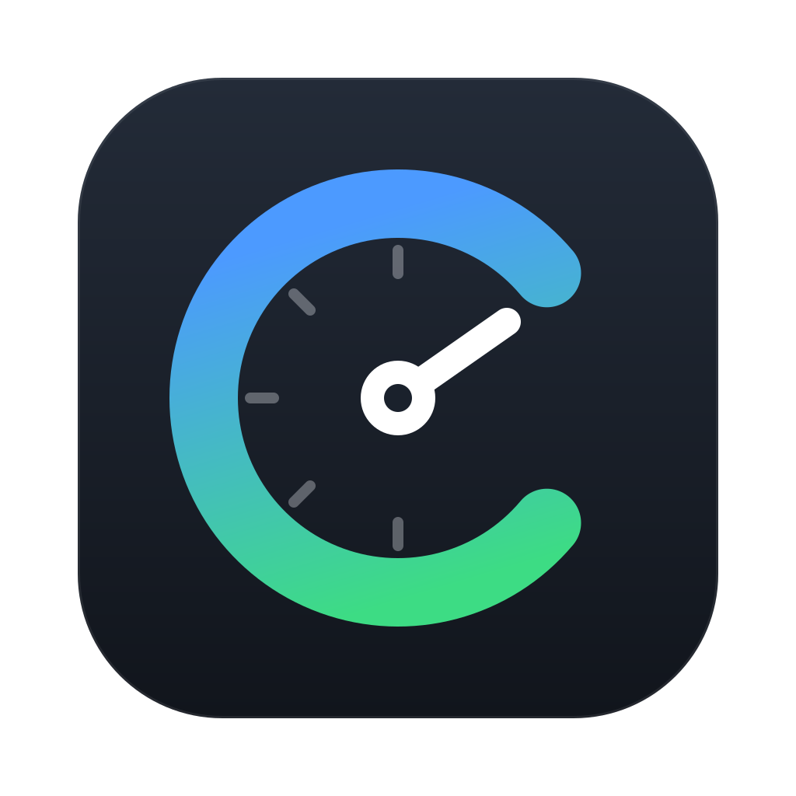
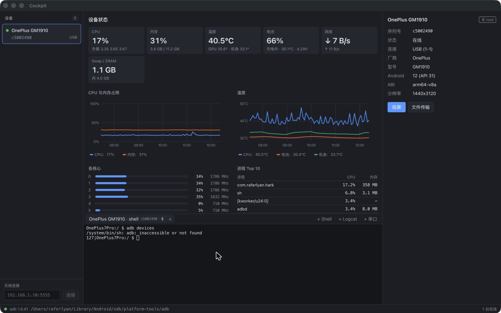
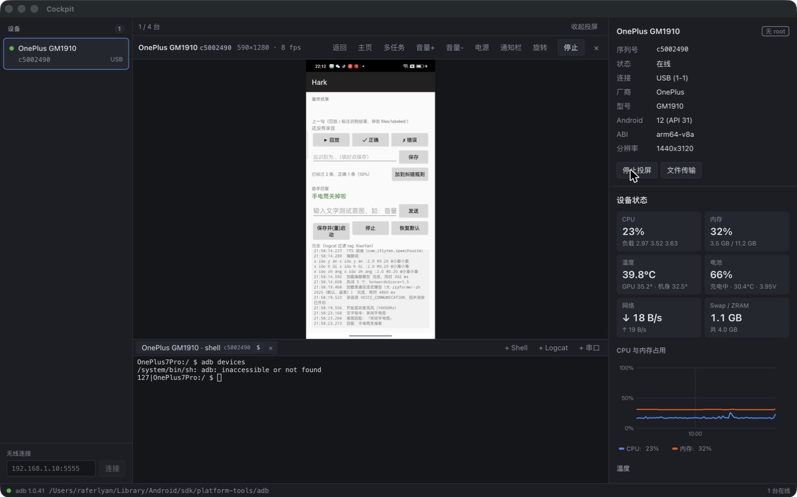
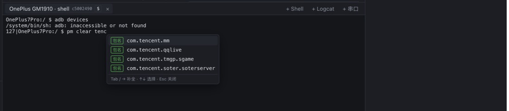
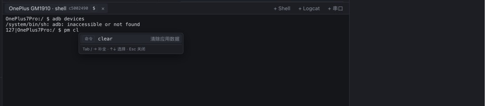
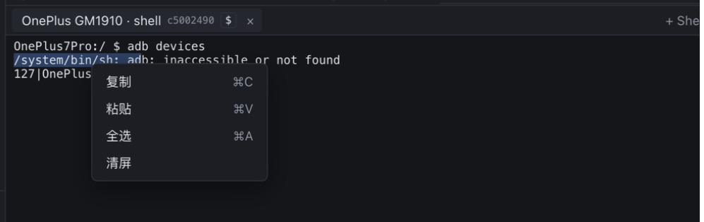
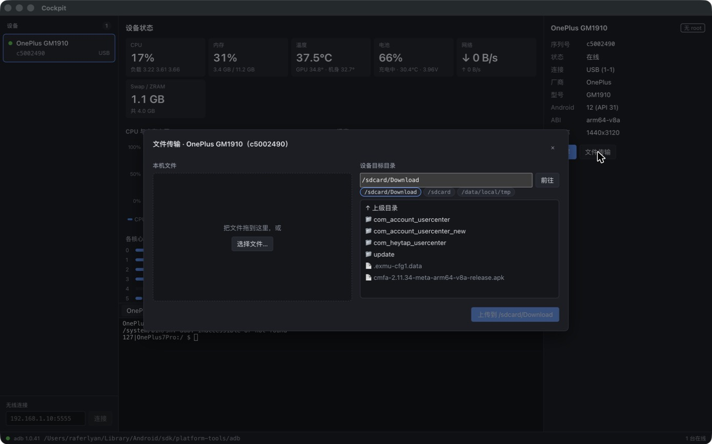

<p align="center">
  
</p>

<h1 align="center">Cockpit</h1>

<p align="center">
  <b>Mirroring, terminals, load monitoring and file transfer in one window.</b><br>
  A desktop tool for debugging Android devices · macOS and Windows · needs only adb, nothing to install on the phone
</p>

<p align="center">
  <a href="https://github.com/raferlyan/CockPit/releases/latest"><b>Download</b></a> ·
  <a href="docs/manual/Cockpit产品使用说明书.pdf">Illustrated manual (Chinese, PDF)</a> ·
  <a href="docs/USER_GUIDE.md">User guide (Chinese)</a> ·
  <a href="docs/demo.html">Web demo (Chinese)</a> ·
  <a href="README.md">中文</a> | <b>English</b>
</p>

<p align="center">
  
  <br><sub>Status first: once you pick a device, the middle area refreshes its load every second, device info stays pinned on the right, and the terminal sits below. Screenshots are from a real OnePlus GM1910 (Android 12); the UI is in Chinese.</sub>
</p>

## Why use it

| Before | With Cockpit |
|---|---|
| scrcpy in a separate window | Mirroring embedded in the main window, up to 4 devices at once |
| Remembering serials and typing `adb -s <serial> shell` for each device | Pick a device and click "+ Shell"; the tab shows the device name and serial |
| Cycling through `top`, `dumpsys battery`, `cat /sys/class/thermal/…` | CPU, memory, temperature, battery, network, processes and storage refreshed every second, with 5-minute charts |
| Forgetting `pm` / `am` / `dumpsys` subcommands and package names | Suggestions as you type: commands, options, packages installed on the device, and your history |
| Typing paths for `adb push` / `adb pull` | Drop files in, pick a device folder and upload; download device files with one click |
| A separate serial tool | Serial tabs in the same terminal area |
| Hand-written perfetto configs, `adb pull`, then ui.perfetto.dev | Pick a preset, click "Record Trace", and it opens in the embedded offline Perfetto |

## Layout: status by default, mirroring when you need it

```
┌──────────┬───────────────────────────────┬────────────────────┐
│ Devices  │ Middle area                   │ Device info (fixed)│
│          │ · default: device status      │ Mirror / Transfer  │
│          │ · after "Mirror": the screen  ├────────────────────┤
│          ├───────────────────────────────┤ Device status      │
│ Wireless │ Terminal: Shell/Logcat/Serial │ (while mirroring,  │
│          │                               │  scrolls)          │
└──────────┴───────────────────────────────┴────────────────────┘
```

Click "Mirror" on the right and the device screen takes the middle while status moves to the right and keeps refreshing; click "Hide mirroring" to go back. Device info stays pinned at the top right, and only the status below it scrolls. The bottom status bar switches between light, dark and system-following themes.

## Device status: see what's eating resources at a glance

- Total CPU usage and `loadavg`, per-core usage and current frequency, with offline cores marked
- Memory and swap / ZRAM, CPU / GPU / battery / skin temperature, battery level, voltage and charging state
- Network throughput, top 10 processes, storage usage per partition
- Charts cover the last 5 minutes; with several devices connected, switch to "Compare" to overlay CPU, memory or temperature

## Mirroring and control: one click puts the screen in the middle

<p align="center">
  
</p>

Built on the [scrcpy](https://github.com/Genymobile/scrcpy) 5.0.1 server, decoded in hardware with WebCodecs and embedded in the main window.

- **Mouse**: left button taps, right button is Back, middle button is Home, the wheel scrolls
- **Keyboard**: type directly, including through an input method such as Chinese; the clipboard syncs both ways (Cmd/Ctrl+C, Cmd/Ctrl+V)
- **Toolbar**: Back, Home, Recents, Volume, Power, Notifications, Rotate
- **Multiple devices**: up to 4 at once, side by side or one at a time; switching doesn't interrupt the others, and resolution and bitrate drop automatically when several are mirrored
- The title shows the device name and serial; drop files on the screen to open the transfer window

## Terminal: an adb shell that suggests commands and packages

<table>
  <tr>
    <td width="50%"><br><sub>Packages match on any part of the name, read from <code>pm list packages</code> on the device</sub></td>
    <td width="50%"><br><sub>Subcommands come with a description; Tab or → accepts</sub></td>
  </tr>
</table>

Shell, Logcat and serial tabs share one terminal area. Each tab shows the device name and serial, plus `$` for a normal user or `#` for root.

- **Suggestions**: commands, subcommands, options and values pop up as you type; after `pm clear`, `am force-stop` or `monkey -p` you get the packages installed on the device, so `tencent` finds `com.tencent.mm`; commands you've run come first next time
- **Copy and paste**: <kbd>⌘C</kbd> / <kbd>⌘V</kbd> on macOS, <kbd>Ctrl+Shift+C</kbd> / <kbd>Ctrl+Shift+V</kbd> on Windows, or the right-click menu (Copy, Paste, Select all, Clear)
- **Drop files**: drag a file from your computer into the terminal to insert its absolute path
- **Logcat**: colored output with optional filters such as `-s ActivityManager` or `--pid=$(pidof -s com.example)`
- **Serial console**: talks to a device's debug UART through a USB-to-serial cable, no adb needed; configurable baud rate, data bits, parity, stop bits, flow control and line ending, with in-place reconnect after unplugging

<p align="center">
  
</p>

## File transfer: pick the device folder first, choose where downloads go

<p align="center">
  
</p>

- The left side lists the absolute path of each local file; drop files in or click "Choose files…"
- On the right, pick a device folder: type it, click a shortcut (`/sdcard/Download`, `/sdcard`, `/data/local/tmp`), or browse level by level
- Missing folders are created, and one failed file doesn't stop the rest
- Click "Download" on any file or folder in the list to save it to a folder on your computer

## Get started in three steps

1. **Install adb**: get [Android SDK Platform-Tools](https://developer.android.com/tools/releases/platform-tools). Cockpit looks in `ANDROID_HOME` / `ANDROID_SDK_ROOT`, then `PATH`, then the default SDK location, and shows the path it found in the bottom status bar.
2. **Install Cockpit**: download the installer for your platform from [Releases](https://github.com/raferlyan/CockPit/releases/latest).

   | Platform | File |
   |---|---|
   | macOS (Apple silicon) | `Cockpit-<version>-mac-arm64.dmg` |
   | macOS (Intel) | `Cockpit-<version>-mac-x64.dmg` |
   | Windows 10 1809 or later (x64) | `Cockpit-<version>-win-x64.exe` |

   The installers are not signed with a developer certificate yet, so the OS blocks the first launch:
   - **macOS**: drag Cockpit into Applications, then in Finder right-click Cockpit → Open → Open. If macOS says the app "is damaged and can't be opened", run `xattr -cr /Applications/Cockpit.app` in Terminal.
   - **Windows**: when SmartScreen appears, click "More info" → "Run anyway".
3. **Connect a device**: enable Developer options → USB debugging on the phone and accept the authorization prompt; a green dot on the left means it's online. For wireless debugging, enter `IP:port` at the bottom left and click "Connect".

For the serial console, install the driver for your USB-to-serial chip (CH340, CP210x, FTDI, etc.). The full [user guide](docs/USER_GUIDE.md) is in Chinese.

## Current limitations

- H.264 is the only supported video codec.
- In progress: root authentication (su password prompts), root-only metrics, and browsing app-private storage (SharedPreferences, MMKV, DataStore, SQLite).
- Audio forwarding is not supported yet.

## Development

Requires Node 22+ and adb.

```bash
npm install
npm run dev
```

| Command | Description |
|---|---|
| `npm run dev` | Development mode with hot reload |
| `npm run typecheck` | Type checking |
| `npm test` | Unit tests |
| `npm run fetch-server` | Download and verify scrcpy-server |
| `npm run fetch-perfetto` | Download and verify the embedded Perfetto UI (pinned version, ~64 MB) |
| `npm run package` | Build the unpacked app into `release/` |
| `npm run dist:mac` / `npm run dist:win` | Build installers |

**App icon**: the source is [docs/assets/logo.svg](docs/assets/logo.svg). After editing it, run `npx electron scripts/render-icon.cjs` to regenerate `build/icon.png`, which packaging uses.

**Releasing**: bump the version in `package.json`, then push a tag starting with `v` (for example `git tag v0.2.0 && git push origin v0.2.0`). GitHub Actions builds the macOS and Windows installers and publishes them to Releases.

**Web demo**: [docs/demo.html](docs/demo.html) is a single static page; its screenshots live in [docs/assets/screenshots](docs/assets/screenshots) and are shared with both READMEs.

See [docs/DESIGN.md](docs/DESIGN.md) for the architecture and module design (in Chinese).

## Tech stack

Electron · React · TypeScript · Zustand · xterm.js · node-pty · serialport · uPlot · WebCodecs · scrcpy-server

## License

[Apache License 2.0](LICENSE). scrcpy-server comes from [Genymobile/scrcpy](https://github.com/Genymobile/scrcpy) and is also licensed under Apache 2.0.
