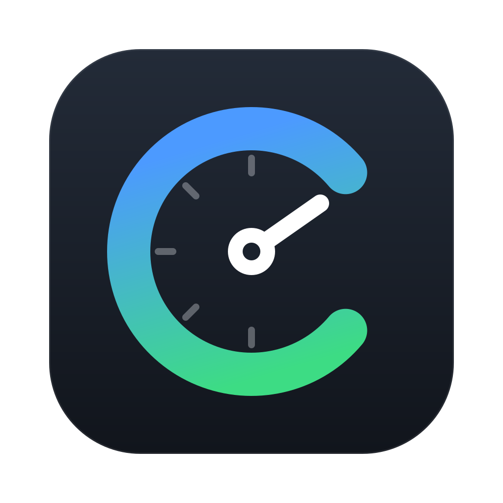
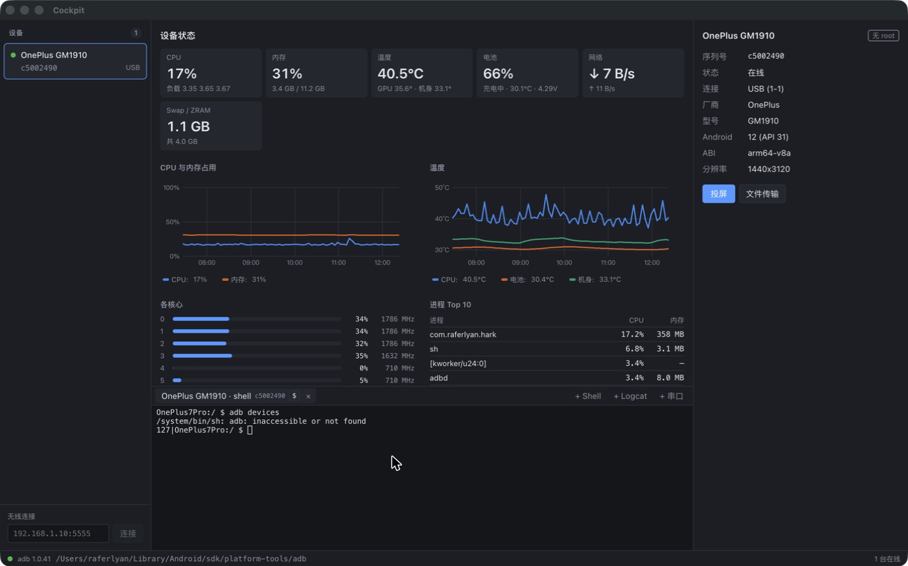
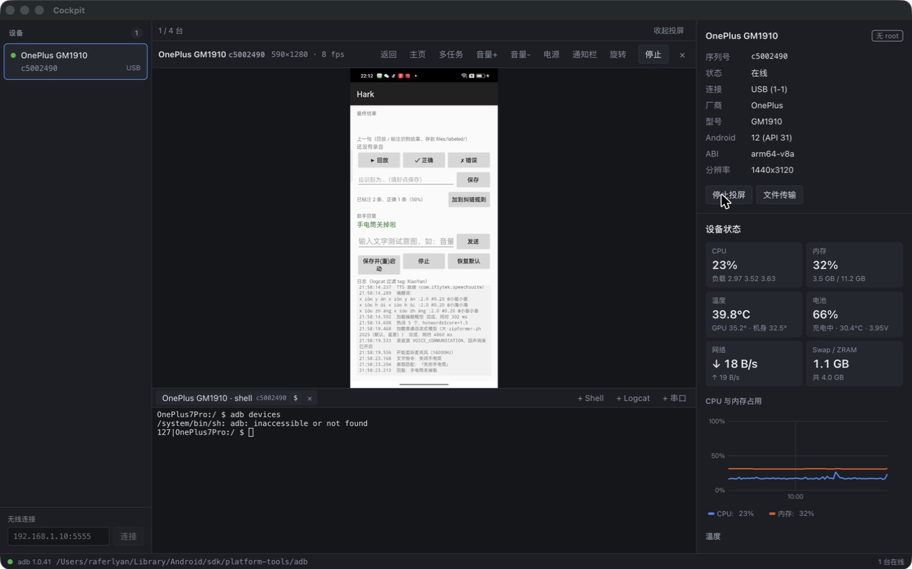
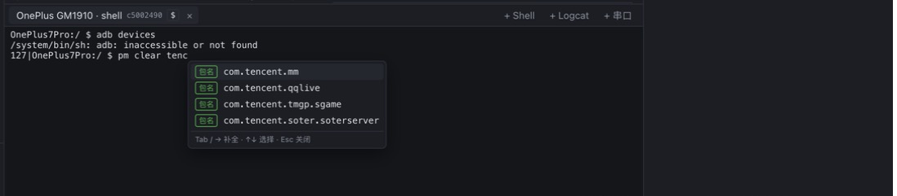
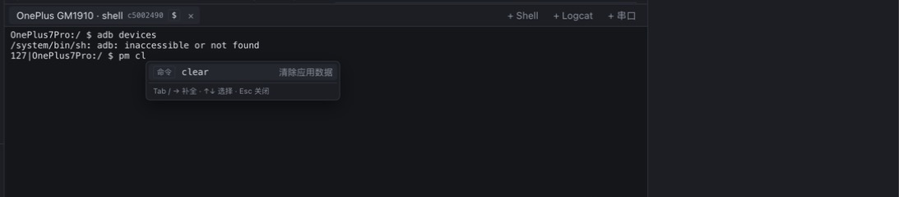
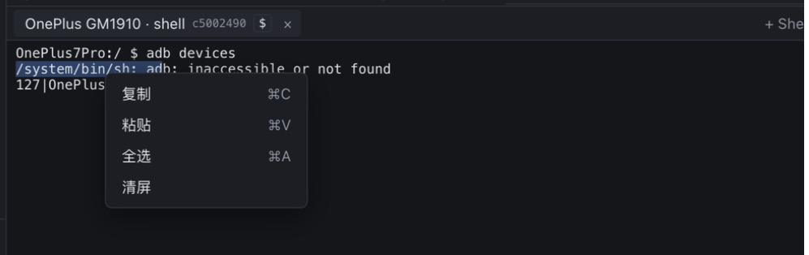
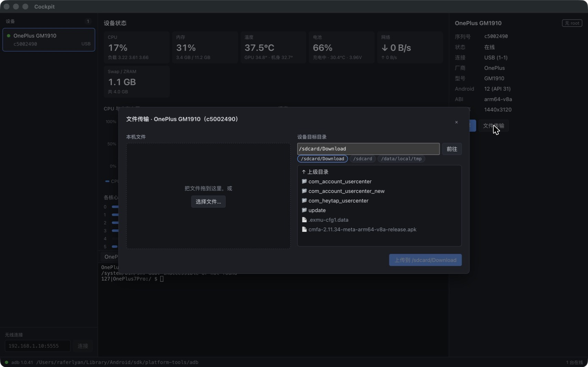

<p align="center">
  
</p>

<h1 align="center">Cockpit</h1>

<p align="center">
  <b>投屏、终端、负载监控、文件传输，一个窗口搞定。</b><br>
  Android 调试桌面工具 · 支持 macOS 与 Windows · 只依赖 adb，手机上不用装任何 App
</p>

<p align="center">
  <a href="https://github.com/raferlyan/CockPit/releases/latest"><b>下载最新版</b></a> ·
  <a href="docs/USER_GUIDE.md">使用说明</a> ·
  <a href="docs/demo.html">网页演示</a> ·
  <b>中文</b> | <a href="README.en.md">English</a>
</p>

<p align="center">
  
  <br><sub>打开即看状态：选中设备后，中间区域每秒刷新负载，右侧固定显示设备信息，下方是终端。截图来自真机 OnePlus GM1910（Android 12）。</sub>
</p>

## 为什么用它

| 以前 | 现在用 Cockpit |
|---|---|
| scrcpy 另开一个窗口投屏 | 投屏嵌在主窗口，最多 4 台同时投 |
| 多台设备要记序列号，敲 `adb -s <序列号> shell` | 选中设备点「+ Shell」，标签上直接显示设备名和序列号 |
| `top`、`dumpsys battery`、`cat /sys/class/thermal/…` 轮着看 | CPU、内存、温度、电池、网络、进程、存储每秒刷新，带 5 分钟曲线 |
| 记不住 `pm` / `am` / `dumpsys` 的子命令和包名 | 边输入边提示命令、选项、设备上的包名和历史命令 |
| `adb push` / `adb pull` 手敲路径 | 拖文件进来，选好设备目录就上传；设备上的文件点一下下载 |
| 串口工具另装一个软件 | 同一个终端区开串口标签 |

## 界面：默认看状态，需要时再投屏

```
┌──────────┬───────────────────────────────┬────────────────┐
│ 设备列表  │ 中间区域                        │ 设备信息（固定） │
│          │ · 默认：设备状态                 │ 投屏 / 文件传输  │
│          │ · 点「投屏」后：投屏画面          ├────────────────┤
│          ├───────────────────────────────┤ 设备状态        │
│ 无线连接  │ 终端：Shell / Logcat / 串口      │（投屏时，可滚动）│
└──────────┴───────────────────────────────┴────────────────┘
```

点右侧「投屏」，画面换到中间，设备状态挪到右侧继续刷新；点「收起投屏」回来。设备信息始终固定在右上方，只有下面的状态区滚动。底部状态栏可以切换「白天 / 黑夜 / 自适应」主题，自适应跟随系统深浅色。

## 设备状态：每秒刷新，一眼看出谁在吃资源

- CPU 总占用和 `loadavg`，每个核心的占用和当前频率，离线核心会标出来
- 内存与 Swap / ZRAM，CPU / GPU / 电池 / 机身温度，电池电量、电压和充电状态
- 网络上下行速率、进程 Top 10、各分区存储占用
- 最近 5 分钟曲线；连了多台设备可以切到「对比」，把 CPU、内存或温度画在一张图上

## 投屏与操控：点一下「投屏」，画面直接换到中间

<p align="center">
  
</p>

基于 [scrcpy](https://github.com/Genymobile/scrcpy) 5.0.1 服务端，画面用 WebCodecs 硬件解码后嵌在主窗口里。

- **鼠标**：左键触摸，右键返回，中键主页，滚轮滚动
- **键盘**：直接打字，中文输入法可用；电脑和手机双向剪贴板（Cmd/Ctrl+C、Cmd/Ctrl+V）
- **工具栏**：返回、主页、多任务、音量、电源、通知栏、旋转
- **多设备**：最多 4 台同时投屏，网格并排或单台切换，切换时其它设备不断流；多台时自动降低分辨率和码率
- 标题显示设备名和序列号；把文件拖到画面上直接打开传输窗口

## 终端：会提示命令和包名的 adb shell

<table>
  <tr>
    <td width="50%"><br><sub>包名模糊匹配，数据来自真机上的 <code>pm list packages</code></sub></td>
    <td width="50%"><br><sub>子命令带中文说明，Tab 或 → 采用</sub></td>
  </tr>
</table>

Shell、Logcat、串口在同一个终端区，多标签。标签上显示设备名和序列号，`$` 是普通用户，`#` 是 root。

- **智能提示**：输入时弹出命令、子命令、选项和参数候选；在 `pm clear`、`am force-stop`、`monkey -p` 后提示设备上的包名，输入 `tencent` 就能找到 `com.tencent.mm`；执行过的命令记为历史，下次排在最前
- **复制粘贴**：macOS 用 <kbd>⌘C</kbd> / <kbd>⌘V</kbd>，Windows 用 <kbd>Ctrl+Shift+C</kbd> / <kbd>Ctrl+Shift+V</kbd>，也可以右键菜单（复制、粘贴、全选、清屏）
- **拖入文件**：把电脑上的文件拖进终端，插入它的绝对路径
- **Logcat**：带颜色，可附加过滤参数，如 `-s ActivityManager` 或 `--pid=$(pidof -s 包名)`
- **串口**：通过 USB 转串口线连接设备调试串口，不依赖 adb；可设置波特率、数据位、校验、停止位、流控和换行符，拔线后原地重连

<p align="center">
  
</p>

## 文件传输：选好设备目录再上传，下载也能指定位置

<p align="center">
  
</p>

- 左边列出本机文件的绝对路径，拖进来或点「选择文件…」
- 右边选设备目录：直接输入、点快捷目录 `/sdcard/Download`、`/sdcard`、`/data/local/tmp`，或逐级浏览
- 目录不存在自动创建，单个文件失败不影响其它文件
- 目录里的文件或文件夹点「下载」，保存到电脑上指定的目录

## 三步开始用

1. **装 adb**：安装 [Android SDK Platform-Tools](https://developer.android.com/tools/releases/platform-tools)。Cockpit 会依次在 `ANDROID_HOME` / `ANDROID_SDK_ROOT`、`PATH`、SDK 默认安装位置查找，底部状态栏显示找到的路径。
2. **装 Cockpit**：到 [Releases](https://github.com/raferlyan/CockPit/releases/latest) 下载对应平台的安装包。

   | 平台 | 文件 |
   |---|---|
   | macOS（Apple 芯片） | `Cockpit-<版本>-mac-arm64.dmg` |
   | macOS（Intel） | `Cockpit-<版本>-mac-x64.dmg` |
   | Windows 10 1809 及以上（x64） | `Cockpit-<版本>-win-x64.exe` |

   安装包目前没有开发者签名，首次打开会被系统拦截：
   - **macOS**：把 Cockpit 拖进「应用程序」后，在 Finder 里右键 Cockpit →「打开」→ 再点「打开」。提示“已损坏，无法打开”时在终端执行 `xattr -cr /Applications/Cockpit.app`。
   - **Windows**：SmartScreen 提示时点「更多信息」→「仍要运行」。
3. **连设备**：手机打开「开发者选项 → USB 调试」，连接后在手机上允许调试授权，左侧出现绿点即在线。无线调试在左下角输入 `IP:端口` 点「连接」。

使用串口时，电脑需要装好 USB 转串口芯片（CH340、CP210x、FTDI 等）的驱动。完整操作说明见 [使用说明](docs/USER_GUIDE.md)。

## 当前限制

- 视频编码只支持 H.264。
- root 认证（su 密码交互）、需要 root 权限的指标，以及应用私有存储浏览（SharedPreferences、MMKV、DataStore、SQLite）还在开发中。
- 音频转发尚未支持。

## 开发

需要 Node 22+ 和 adb。

```bash
npm install
npm run dev
```

国内网络下 Electron 二进制下载慢时，用环境变量指定镜像（npm 11 起 `.npmrc` 里的 `ELECTRON_MIRROR` 不再生效）：

```bash
ELECTRON_MIRROR=https://npmmirror.com/mirrors/electron/ npm install
```

| 命令 | 说明 |
|---|---|
| `npm run dev` | 开发模式（热更新） |
| `npm run typecheck` | 类型检查 |
| `npm test` | 单元测试 |
| `npm run fetch-server` | 下载并校验 scrcpy-server |
| `npm run package` | 构建未打包的应用目录到 `release/` |
| `npm run dist:mac` / `npm run dist:win` | 生成安装包 |

**应用图标**：源文件是 [docs/assets/logo.svg](docs/assets/logo.svg)。修改后执行 `npx electron scripts/render-icon.cjs`，重新生成打包用的 `build/icon.png`。

**发布新版本**：修改 `package.json` 里的版本号，然后推送 `v` 开头的标签（如 `git tag v0.2.0 && git push origin v0.2.0`）。GitHub Actions 会构建 macOS 与 Windows 安装包，并发布到 Releases。

**网页演示**：[docs/demo.html](docs/demo.html) 是单文件静态页，截图在 [docs/assets/screenshots](docs/assets/screenshots)，README 与演示页共用。

架构与模块设计见 [docs/DESIGN.md](docs/DESIGN.md)。

## 技术栈

Electron · React · TypeScript · Zustand · xterm.js · node-pty · serialport · uPlot · WebCodecs · scrcpy-server

## 许可证

[Apache License 2.0](LICENSE)。scrcpy-server 来自 [Genymobile/scrcpy](https://github.com/Genymobile/scrcpy)，同样采用 Apache 2.0 许可证。
