# Cockpit 产品使用说明书

> 适用版本：v0.5.0 · 更新日期：2026-11-05 · 支持系统：macOS 12 及以上（Apple 芯片 / Intel）、Windows 10/11
>
> 本文截图均来自 v0.5.0 实际运行界面，示例设备为一加 7 Pro（Android 12）。

---

## 目录

1. [产品简介](#1-产品简介)
2. [安装与准备](#2-安装与准备)
3. [界面总览](#3-界面总览)
4. [设备列表与设备信息](#4-设备列表与设备信息)
5. [设备状态监控](#5-设备状态监控)
6. [投屏与操控](#6-投屏与操控)
7. [终端：Shell / Logcat / 本机终端 / 串口](#7-终端shell--logcat--本机终端--串口)
8. [进入 root](#8-进入-root)
9. [文件传输](#9-文件传输)
10. [应用管理](#10-应用管理)
11. [截图与标注](#11-截图与标注)
12. [导出设备日志](#12-导出设备日志)
13. [录制与分析 Trace（Perfetto）](#13-录制与分析-traceperfetto)
14. [操作日志](#14-操作日志)
15. [设置与个性化](#15-设置与个性化)
16. [常见问题](#16-常见问题)
17. [附录](#17-附录)

---

## 1. 产品简介

Cockpit 是面向 Android 开发、测试和系统调试人员的桌面工具，把平时要开好几个窗口才能完成的工作集中到一个窗口里：

| 以前的做法 | 在 Cockpit 里 |
|---|---|
| 单独开 scrcpy 窗口投屏 | 投屏嵌在主窗口中，最多 4 台设备同时投屏 |
| 终端里敲 `adb -s <序列号> shell`，多台设备要记序列号 | 选中设备点「+ Shell」，标签上直接显示设备名和序列号 |
| 轮流执行 `top`、`dumpsys battery`、`cat /sys/class/thermal/...` | CPU、内存、温度、电池、网络、进程、存储每秒刷新，带 5 分钟曲线 |
| 手敲 `adb push` / `adb pull` 的路径 | 拖文件进来、选好设备目录即可上传，有分步进度；设备上的文件点一下就能下载 |
| su 要手动输密码，或者拿挑战码去解密工具里算 | 右键「进入 root」，四种方式自动完成，包括调用本机解密工具 |
| 串口工具、PowerShell 另开窗口 | 同一个终端区里开串口标签和本机终端标签 |
| 录 trace 要写配置、`adb pull` 再拖进网页 | 选预设一键录制，录完自动在内嵌的离线 Perfetto 中打开 |
| 想知道某个操作背后执行了什么 adb 命令 | 操作日志记下每次操作执行的命令，可以直接复制使用 |

Cockpit 只依赖电脑上的 adb，**手机上不需要安装任何 App**。

---

## 2. 安装与准备

### 2.1 系统要求

| 项目 | 要求 |
|---|---|
| 电脑 | macOS 12 及以上，或 Windows 10/11（64 位） |
| adb | Android SDK Platform-Tools |
| 手机 | 已开启「USB 调试」的 Android 设备；投屏需要 Android 5.0 及以上，录制 Trace 需要 Android 10 及以上 |

### 2.2 安装 adb

下载 [Android SDK Platform-Tools](https://developer.android.com/tools/releases/platform-tools) 并解压。Cockpit 会自动按以下顺序查找 adb：

1. 环境变量 `ANDROID_HOME` / `ANDROID_SDK_ROOT` 下的 `platform-tools`；
2. 系统 `PATH`；
3. Android SDK 的默认安装位置（如 macOS 的 `~/Library/Android/sdk`）。

找到后，窗口底部状态栏左侧会显示 adb 版本和路径，例如 `adb 1.0.41 /Users/.../platform-tools/adb`。

### 2.3 安装 Cockpit

到 [GitHub Releases](https://github.com/raferlyan/CockPit/releases/latest) 下载对应的安装包：

| 系统 | 文件 |
|---|---|
| macOS（Apple 芯片） | `Cockpit-<版本>-mac-arm64.dmg` |
| macOS（Intel） | `Cockpit-<版本>-mac-x64.dmg` |
| Windows 10/11 | `Cockpit-<版本>-win-x64.exe` |

安装包没有代码签名，首次打开时：

- **macOS**：如果提示“无法验证开发者”，在 Finder 里右键 Cockpit →「打开」。如果提示“已损坏”，在终端执行 `xattr -cr /Applications/Cockpit.app`。
- **Windows**：如果出现 SmartScreen 提示，点「更多信息」→「仍要运行」。

### 2.4 连接设备

**USB 连接**

1. 手机进入「设置 → 关于手机」，连续点击「版本号」7 次，打开开发者选项。
2. 在「开发者选项」中打开「USB 调试」。
3. 用支持数据传输的数据线连接电脑，在手机弹出的授权框中点「允许」。
4. 设备出现在 Cockpit 左侧列表，绿点表示在线。

**无线连接**

1. 手机与电脑连接同一网络，在开发者选项中开启「无线调试」（或先用 USB 执行 `adb tcpip 5555`）。
2. 在 Cockpit 左下角「无线连接」输入框中填写 `IP:端口`，例如 `192.168.1.10:5555`，点「连接」。
3. 连接成功后，设备和 USB 设备一样出现在列表中，标注为 Wi-Fi。

### 2.5 使用向导

首次打开 Cockpit 时会自动启动使用向导，用聚光灯逐个介绍界面上的主要功能，共 20 步。按「下一步」继续，按 Esc 或点「跳过」退出。之后可以在「设置 → 查看使用向导」中再次打开。

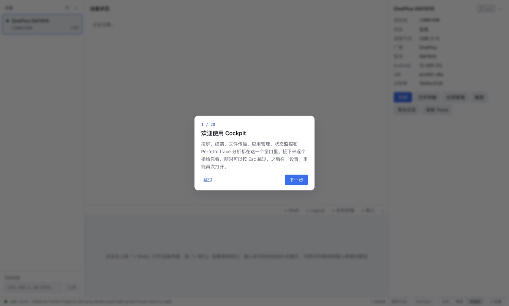

*图 2-1　首次启动时的使用向导*

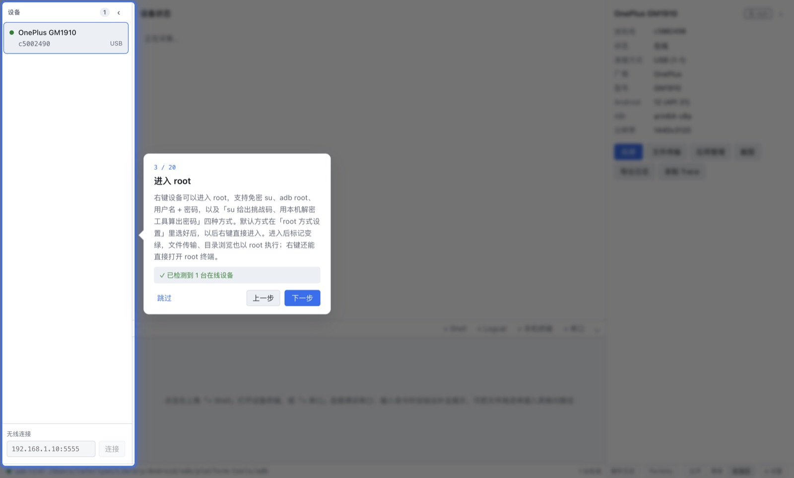

*图 2-2　向导会高亮对应区域并说明用法；有在线设备时会显示检测结果*

---

## 3. 界面总览

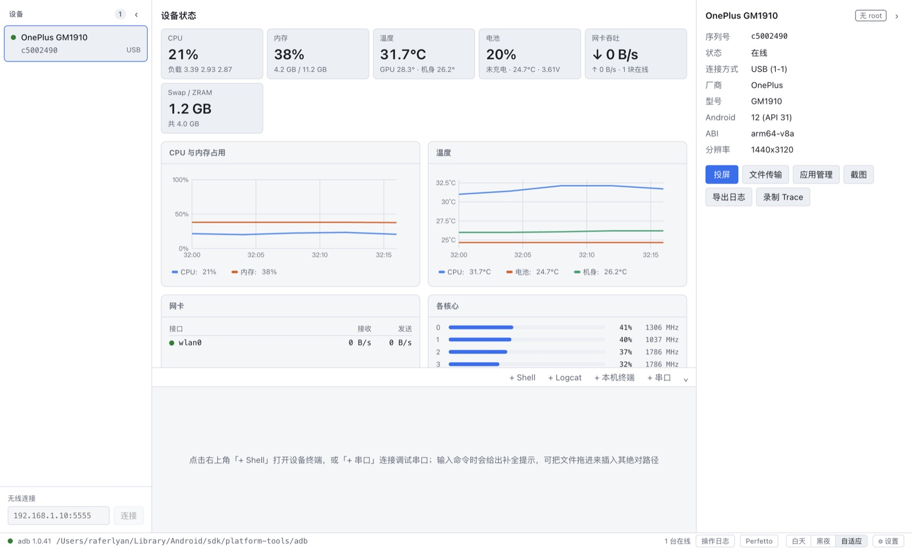

*图 3-1　Cockpit 主界面*

主界面分为五个区域：

| 区域 | 位置 | 内容 |
|---|---|---|
| 设备列表 | 左侧 | 已连接的设备，右键可进入 root；底部是无线连接输入框 |
| 中间区域 | 中上 | 默认显示选中设备的实时状态；投屏时换成投屏画面；打开 Perfetto 时显示 trace 查看器 |
| 设备信息 | 右侧 | 序列号、型号、Android 版本等固定信息，以及投屏、文件传输、应用管理、截图、导出日志、录制 Trace 六个功能按钮 |
| 终端区 | 中下 | Shell、Logcat、本机终端、串口等多标签终端 |
| 状态栏 | 底部 | adb 版本与路径、在线设备数、操作日志、Perfetto 入口、主题切换、设置 |

**调整布局**

- 拖动区域之间的边框调整大小，双击边框恢复默认。
- 设备列表、设备信息和终端的标题栏右侧都有收起箭头。收起后变成贴边的图标条，点击图标条重新展开。收起和展开都有带回弹的过渡动画，终端收起时会话不会断开。
- 对话框、菜单、通知、操作日志面板在打开和关闭时也有淡入淡出和弹性动画。系统开启了「减少动态效果」时，动画会自动关闭。
- 快捷键：

| 操作 | macOS | Windows |
|---|---|---|
| 收起 / 展开设备列表 | ⌘1 | Ctrl+1 |
| 收起 / 展开设备信息 | ⌘2 | Ctrl+2 |
| 收起 / 展开终端 | ⌘3 | Ctrl+3 |
| 一键收起 / 展开全部 | ⌘⇧F12 | Ctrl+Shift+F12 |
| 放大 / 缩小 / 还原界面 | ⌘= / ⌘− / ⌘0 | Ctrl+= / Ctrl+− / Ctrl+0 |

---

## 4. 设备列表与设备信息

### 4.1 设备列表

每台设备显示设备名、序列号和连接方式（USB / Wi-Fi）：

- **绿点**：在线，可以使用全部功能。
- **黄点**：未授权、离线等状态，同时显示状态文字。未授权时请在手机上确认调试授权。
- **root 标记**：设备名右侧的小标签，含义见 [8.6 root 状态标记](#86-root-状态标记)。

单击选中设备，中间区域和右侧信息都会切换到这台设备。**右键设备**可以进入 root、打开 root 终端、设置 root 方式，详见第 8 章。

### 4.2 设备信息

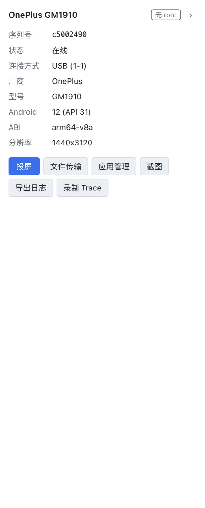

*图 4-1　设备信息面板*

右侧上方固定显示序列号、状态、连接方式、厂商、型号、Android 版本（API 级别）、ABI 和物理分辨率，右上角显示 root 状态。下面是六个功能按钮：

| 按钮 | 功能 | 章节 |
|---|---|---|
| 投屏 | 在中间区域显示并操控手机画面 | 第 6 章 |
| 文件传输 | 本机与设备之间上传、下载文件 | 第 9 章 |
| 应用管理 | 查看、卸载、停用、导出应用 | 第 10 章 |
| 截图 | 原始分辨率截图，可标注 | 第 11 章 |
| 导出日志 | 批量导出设备上的日志目录 | 第 12 章 |
| 录制 Trace | 用 perfetto 录制系统 trace | 第 13 章 |

> **小技巧**：把 APK 拖到设备信息区域会直接安装；拖入其它文件会打开「文件传输」并带上这些文件。

---

## 5. 设备状态监控

选中在线设备后，中间区域每秒刷新一次这台设备的运行状态。

### 5.1 概览与曲线

| 卡片 / 图表 | 内容 |
|---|---|
| CPU | 总占用率，以及 1 / 5 / 15 分钟负载均值 |
| 内存 | 占用率，已用 / 总量 |
| 温度 | CPU 温度，以及 GPU、机身温度 |
| 电池 | 电量、充电状态、电池温度、电压 |
| 网卡吞吐 | 下行 / 上行速率、在线网卡数 |
| Swap / ZRAM | 已用交换空间和总量 |
| CPU 与内存占用 | 最近 5 分钟的曲线 |
| 温度 | 最近 5 分钟的 CPU、电池、机身温度曲线 |
| 网卡 | 各在线网卡的实时收发速率 |
| 各核心 | 每个核心的占用率和当前频率，离线核心会标出 |
| 进程 Top 10 | 按 CPU 排序，显示 CPU 占用和内存；鼠标悬停显示 PID 和用户 |

连接了多台设备时，「设备状态」标题右侧会出现「单台 / 对比」切换。切到「对比」后，可以把 2～3 台设备的 CPU、内存或温度画在同一张图上。

### 5.2 存储与逐层分析

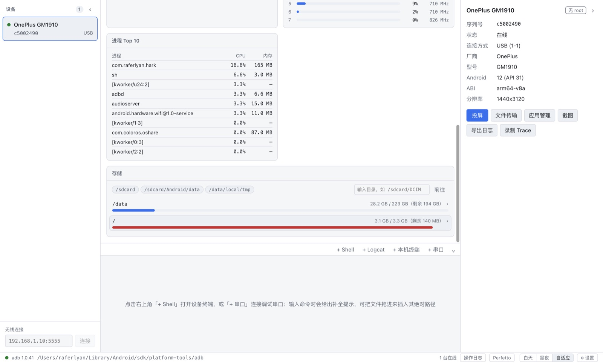

*图 5-1　存储区显示各分区的已用、总量和剩余空间；剩余空间不足的分区用红色标出*

点击分区，或点击 `/sdcard`、`/sdcard/Android/data`、`/data/local/tmp` 快捷目录，也可以在输入框里填写路径后点「前往」，就能逐层查看每个子目录和文件的占用：

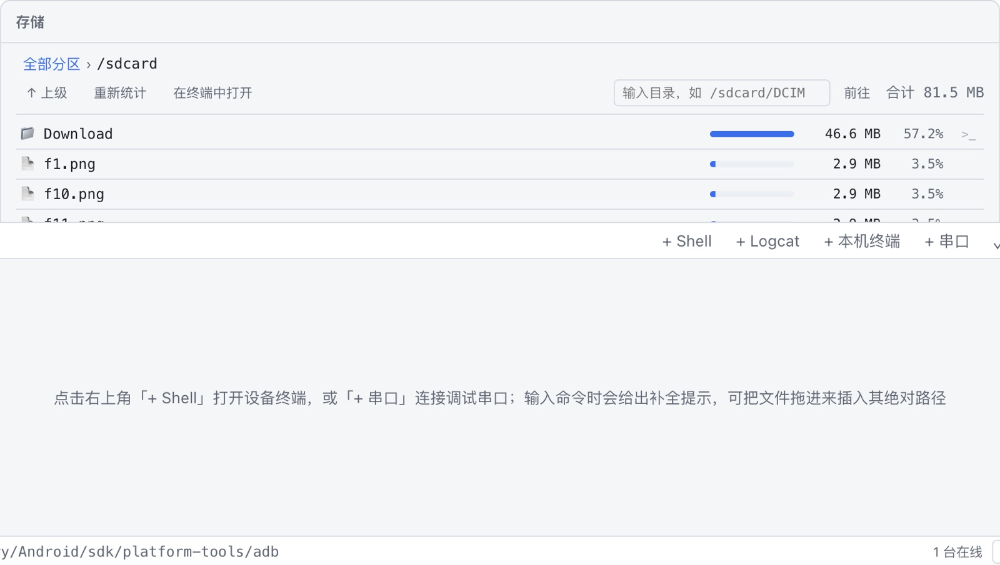

*图 5-2　按大小排序显示子目录和文件的占用和占比*

- 点击文件夹进入下一层；点「全部分区」或面包屑返回上层，也可以点「↑ 上级」。
- 「重新统计」重新计算当前目录。
- 「在终端中打开」或行尾的 `>_` 会新开一个 Shell 标签并 `cd` 到该目录。
- 部分子目录没有读取权限时会提示“统计结果偏小”。已进入 root 或设备有免密 su 时，可以点「用 root 重新统计」。

---

## 6. 投屏与操控

点击右侧的「投屏」，投屏画面会出现在中间区域，设备状态挪到右侧下方继续刷新。

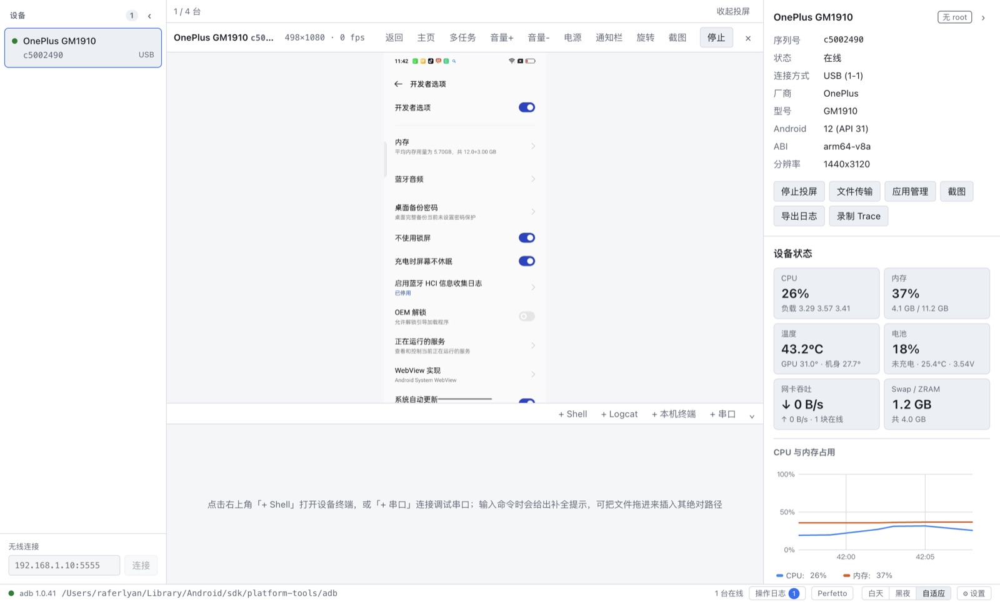

*图 6-1　投屏界面。上方工具栏显示设备名、分辨率和帧率；右侧继续显示设备状态*

**鼠标与键盘**

| 操作 | 效果 |
|---|---|
| 鼠标左键 | 触摸、滑动 |
| 鼠标右键 | 返回（息屏时点亮屏幕） |
| 鼠标中键 | 回到主页 |
| 滚轮 | 滚动 |
| 键盘 | 直接打字，支持中文输入法 |
| ⌘C / ⌘V（Windows：Ctrl+C / Ctrl+V） | 在设备与电脑之间复制粘贴 |

**工具栏**：返回、主页、多任务、音量+、音量-、电源、通知栏、旋转、截图、停止。

**多台同时投屏**

- 投屏区顶部「+ 添加设备」下拉框可以再加一台，最多 4 台。
- 「网格」并排显示所有设备，「单台」只显示一台；切换时其它设备的投屏不会中断。
- 点「收起投屏」回到设备状态视图，投屏随之结束。

> **说明**：目前只支持 H.264 编码。投屏会占用设备的 CPU 和 GPU，分析卡顿或功耗时建议先停止投屏。

把文件拖到投屏画面上，会打开「文件传输」并带上这些文件；拖入 APK 则直接安装。

---

## 7. 终端：Shell / Logcat / 本机终端 / 串口

终端区右上角有四个按钮，每次点击新开一个标签，可以同时开多个：

| 按钮 | 打开的终端 | 需要在线设备 |
|---|---|---|
| + Shell | 当前选中设备的 `adb shell` | 是 |
| + Logcat | 当前选中设备的 logcat，带筛选栏 | 是 |
| + 本机终端（Windows 上为 + PowerShell） | 电脑本机的终端 | 否 |
| + 串口 | 通过 USB 转串口线连接设备调试串口 | 否 |

标签显示「设备名 · 类型 · 序列号」，鼠标悬停可以看到完整序列号。Shell 标签上的 `$` 表示普通用户，`#` 表示 root。设备断开后标签会划掉，点「重新连接」原地重开。

### 7.1 Shell 与命令智能提示

Shell 是完整的交互式终端，支持 Tab 补全、Ctrl+C、vi、top 等程序。输入命令时，光标下方会弹出候选：

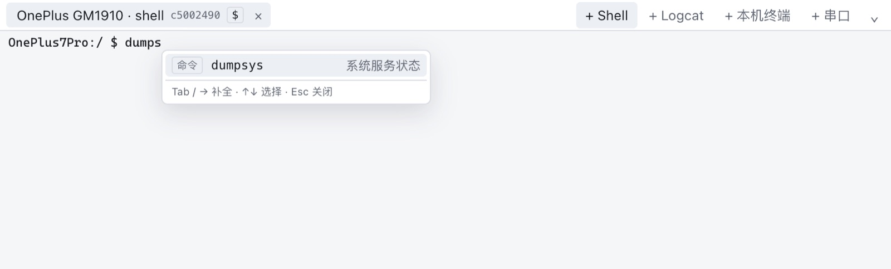

*图 7-1　输入 `dumps` 时提示 `dumpsys`，并附中文说明*

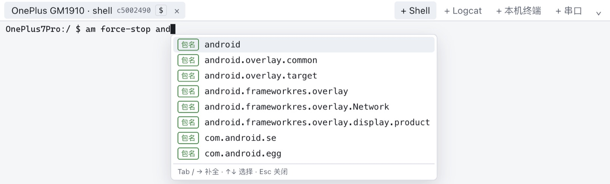

*图 7-2　在 `am force-stop` 后输入 `and`，模糊匹配设备上已安装的包名*

提示的内容包括：

- **命令和子命令**：`am`、`pm`、`dumpsys`、`settings`、`input`、`wm`、`svc`、`cmd`、`logcat` 等，每项都有中文说明。
- **选项和参数**：如 `pm list packages -3`、`logcat -b crash`、`input keyevent KEYCODE_HOME`、`getprop ro.build.version.sdk`。
- **包名**：在 `am force-stop`、`pm clear`、`monkey -p`、`dumpsys meminfo` 等位置提示设备上已安装的应用，支持模糊匹配（输入 `tencent` 能找到 `com.tencent.mm`）。
- **历史命令**：以前执行过的命令排在最前面，标为「历史」。

| 按键 | 作用 |
|---|---|
| Tab 或 → | 采用选中的候选 |
| ↑ / ↓ | 在候选之间切换 |
| Esc | 关闭提示（之后 ↑ / ↓ 恢复为 shell 自己的历史命令） |
| Enter | 执行当前输入的内容，不会自动采用候选 |

没有弹出提示时，Tab 仍是 shell 自带的补全。

### 7.2 Logcat 与筛选

点「+ Logcat」时可以先填启动参数，例如 `-b crash`、`-s ActivityManager`，也可以直接点「打开」。打开后标签上方有筛选栏：

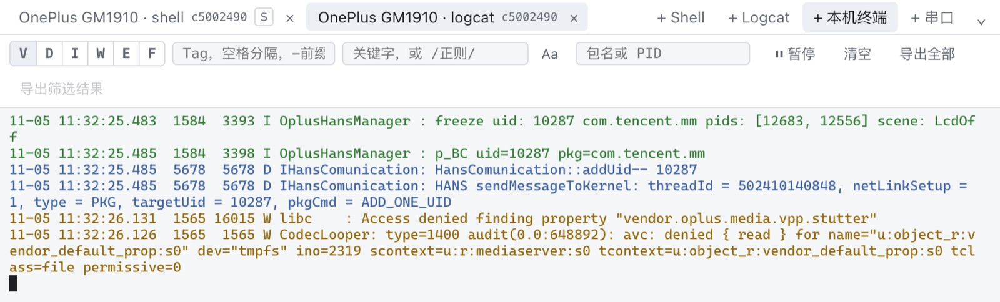

*图 7-3　Logcat 标签与筛选栏，不同级别的日志用不同颜色显示*

筛选条件修改后立即对已缓存的日志重新筛选（最多缓存 10 万行），不需要重开 logcat：

| 控件 | 作用 |
|---|---|
| V D I W E F | 最低级别。如选 W，只显示警告、错误和致命错误 |
| Tag | 空格分隔多个词，Tag 包含任一词即显示；`-chatty` 这样以 `-` 开头的词表示排除 |
| 关键字 | 匹配整行，命中处反色高亮；写成 `/.../` 时按正则匹配，正则写错时输入框变红并提示原因 |
| Aa | 切换关键字是否区分大小写 |
| 包名或 PID | 只看某个应用的日志。填包名时每 3 秒重新查询进程号，应用重启换了 PID 也能自动跟上；应用没在运行时显示「未运行」 |
| 暂停 / 继续 | 暂停滚动方便查看，新日志照常缓存，继续后补上 |
| 清空 | 清掉已缓存的日志 |
| 导出全部 / 导出筛选结果 | 保存为文本文件（去掉颜色码），弹出对话框选择保存位置 |

### 7.3 本机终端

「+ 本机终端」打开电脑本机的终端：Windows 上是 PowerShell（按钮显示为「+ PowerShell」），macOS / Linux 上是用户的登录 shell。

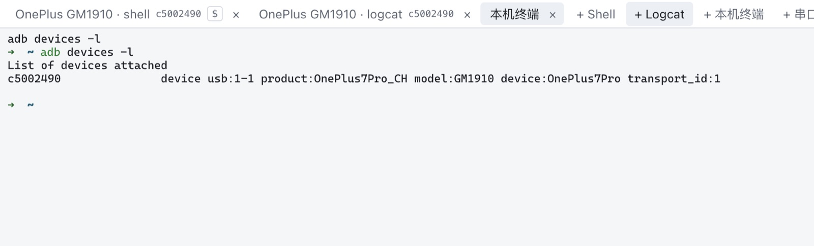

*图 7-4　本机终端里可以直接使用 adb*

- Cockpit 使用的 adb 所在目录已加到这个终端的 `PATH` 最前面，直接敲 `adb` 就是 Cockpit 用的同一个 adb，不会和电脑上别的 adb 版本冲突。
- 本机终端不依赖设备，设备断开时不会关闭。
- 本机终端不弹出设备命令提示；拖入文件时，Windows 上按 PowerShell 的规则给路径加引号。

### 7.4 串口

「+ 串口」通过 USB 转串口线连接设备的调试串口，不需要 adb，也不需要设备在线。

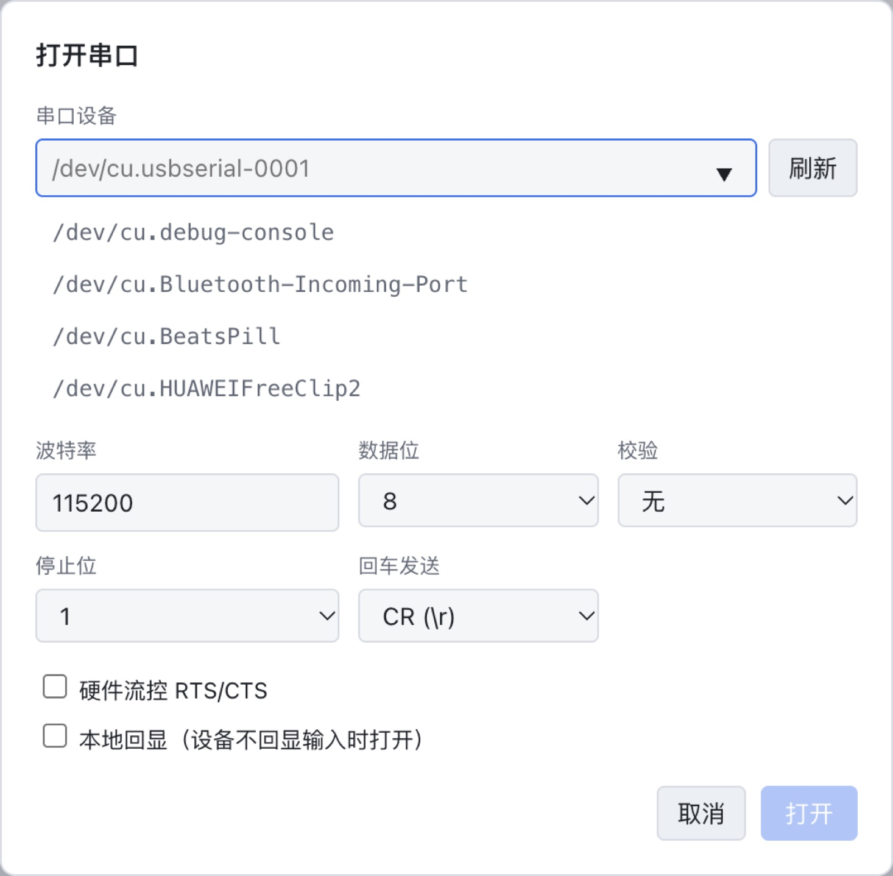

*图 7-5　选择串口设备并设置通信参数*

| 参数 | 说明 |
|---|---|
| 串口设备 | 下拉选择，或点「刷新」重新扫描 |
| 波特率 | 默认 115200 |
| 数据位 / 校验 / 停止位 | 默认 8 / 无 / 1 |
| 回车发送 | 按回车时发送 CR、LF 或 CRLF |
| 硬件流控 RTS/CTS | 按设备要求勾选 |
| 本地回显 | 设备不回显输入时打开 |

### 7.5 复制、粘贴与拖入文件

| 操作 | macOS | Windows |
|---|---|---|
| 复制选中文字 | ⌘C，或选中后按 Ctrl+C | Ctrl+Shift+C，或选中后按 Ctrl+C |
| 粘贴 | ⌘V 或 Ctrl+V | Ctrl+V 或 Ctrl+Shift+V |
| 全选 | ⌘A | 右键菜单 |

- 鼠标拖动选中文字后，也可以右键选择「复制 / 粘贴 / 全选 / 清屏」。
- 没有选中文字时，Ctrl+C 仍然是中断当前命令。
- 把电脑上的文件或文件夹拖进 Shell、本机终端或串口终端，会在光标处插入它们的绝对路径（含空格时自动加引号）。

终端字体和字号在「设置」中单独调整，默认使用 Cascadia Mono（随应用打包，macOS 上同样可用）。

---

## 8. 进入 root

### 8.1 先分清 root 和 remount

> 这是最容易混淆的地方，遇到“写不进去”时请先看这一节。

- **root** 解决的是“有没有权限”。普通 adb 身份（shell 用户）不能写 `/data/app` 这类目录，root 后可以。
- **remount** 解决的是“分区能不能写”。`/system`、`/vendor`、`/product` 等分区默认以**只读**方式挂载，即使已经是 root，不重新挂载为可写（remount）也写不进去。
- 在某个终端里手动执行 `su`，只让**这一个终端**变成 root。Cockpit 的文件传输，以及电脑终端里直接执行的 `adb push`，用的仍然是 adbd 的 shell 身份，与哪个终端 su 过无关。

因此，往系统分区放文件通常需要两步：**先进入 root，再 remount**。Cockpit 会在上传前自动判断缺的是哪一步，并给出处理办法（见 [9.3 上传失败的原因与处理](#93-上传失败的原因与处理)）。

### 8.2 右键菜单

在左侧设备列表中**右键设备**：

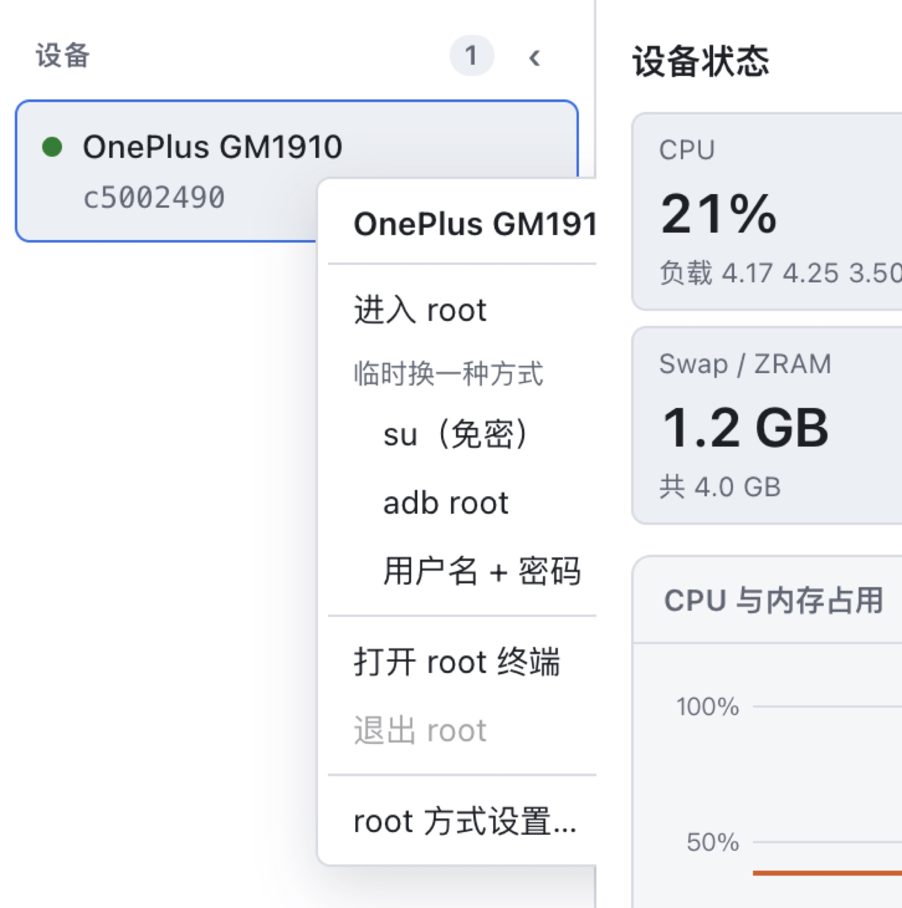

*图 8-1　设备右键菜单。「进入 root」右侧显示当前的默认方式*

| 菜单项 | 作用 |
|---|---|
| 进入 root | 用这台设备的方式进入 root（没有单独指定时用默认方式）。已进入时显示为「重新进入 root」 |
| 临时换一种方式 | 本次改用其它方式进入，不修改设置 |
| 打开 root 终端 | 新开一个 Shell 标签并自动完成 su |
| 退出 root | 结束后台 root 通道；通过 adb root 进入的执行 `adb unroot` |
| root 方式设置… | 打开 root 方式设置（「设置」里的「root 方式…」也能打开） |

### 8.3 四种进入方式

| 方式 | 适用设备 | 过程 |
|---|---|---|
| su（免密） | Magisk、KernelSU，或 userdebug 版本自带的 su | 执行 su，直接得到 root |
| adb root | userdebug / eng 版本 | adbd 以 root 身份重启，之后所有 adb 命令都是 root |
| 用户名 + 密码 | su 后提示输入密码的设备 | 自动填入保存的密码 |
| 解密工具 | su 后先给出挑战码、再要求输入密码的设备 | 执行 su → 读出挑战码 → 交给本机的解密工具 → 把工具算出的密码填入 |

进入成功后，Cockpit 会在后台保持一个 root 会话。之后**文件传输、目录浏览、存储统计、日志导出都通过这个 root 通道执行**，不需要每次重新认证。

### 8.4 root 方式设置

从右键菜单选「root 方式设置…」打开：

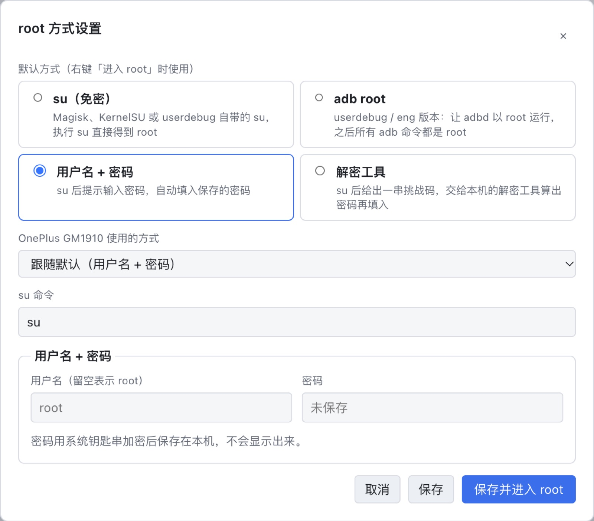

*图 8-2　选择「用户名 + 密码」时显示用户名和密码输入框*

| 设置项 | 说明 |
|---|---|
| 默认方式 | 右键「进入 root」时使用的方式，对所有设备生效 |
| 〈设备名〉使用的方式 | 从某台设备的右键菜单打开时出现。可以为这台设备单独指定方式，默认「跟随默认」 |
| su 命令 | 默认 `su`。个别设备的 su 在 `/system/xbin/su` 等路径下，可以在这里修改 |
| 用户名 | 「用户名 + 密码」方式使用。留空表示 root（执行 `su`），填写后执行 `su <用户名>` |
| 密码 | 用系统钥匙串（macOS 钥匙串 / Windows DPAPI）加密后保存在本机，界面上不会显示明文。已保存时输入框显示「已保存，留空不修改」，可以点「清除已保存的密码」 |

设置好后，点「保存」，或点「保存并进入 root」立即进入。设置一次后，以后右键「进入 root」即可。

### 8.5 使用解密工具

适用于这类设备：执行 `adb shell su` 后，屏幕上先输出一串挑战码，再提示输入密码。以前需要把挑战码复制到解密工具（如 `xxx.exe`）里算出密码，再粘贴回来。Cockpit 会自动完成这个过程。

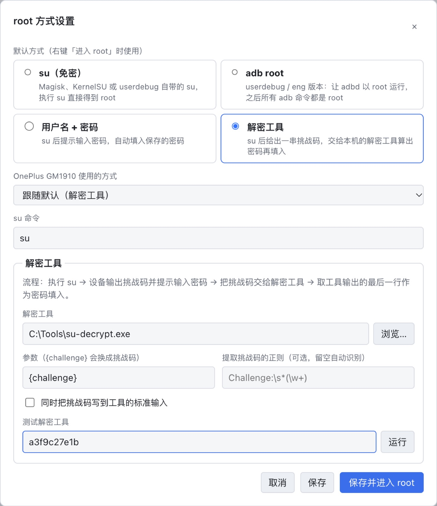

*图 8-3　选择「解密工具」时的设置项*

**配置步骤**

1. 默认方式选「解密工具」（或只为这台设备指定）。
2. 在「解密工具」中填写工具路径，或点「浏览…」选择 exe 文件。
3. 一般不需要修改其它设置。如有需要再调整：
   - **参数**：默认 `{challenge}`，即挑战码作为唯一的参数传入。工具需要其它参数时，可以写成 `-c {challenge}` 这样的形式，`{challenge}` 会被替换为挑战码；含空格的参数用双引号括起来。
   - **同时把挑战码写到工具的标准输入**：工具从键盘读取挑战码时勾选。
   - **提取挑战码的正则**：留空时自动识别（`Challenge: xxx`、`挑战码：xxx` 这类写法，或提示前最后一个字母数字串）。识别不准时可以填正则，例如 `Challenge:\s*(\w+)`，有捕获组时取第一组。
4. 在「测试解密工具」中粘贴一个 su 给出的挑战码，点「运行」，确认工具能算出密码：


*图 8-4　测试结果显示工具输出的密码*

5. 点「保存并进入 root」。

**解密工具的要求**

- 必须能在命令行运行（不需要用户在图形界面里点按钮），并把密码打印到标准输出。
- 输出可以带提示文字，Cockpit 只取**最后一个非空行**作为密码；`password: xxx`、`密码：xxx` 这种带标签的格式也能识别。
- 必须在 20 秒内结束运行。
- Windows 上的 `.bat`、`.cmd` 脚本也可以使用。

**进入过程**

进入时会显示通知，成功或失败后同一条通知会更新结果：


*图 8-5　进入成功的通知，下方注明使用的方式*

### 8.6 root 状态标记

| 标记 | 位置 | 含义 |
|---|---|---|
| 绿色 **root** | 设备列表；设备信息里显示为「root（方式）」 | 已通过右键进入 root，后台 root 通道可用，文件传输等也以 root 执行 |
| 绿色 **root** / **adbd root** | 同上 | adbd 本身以 root 运行（adb root） |
| 黄色 **root** | 同上 | 只是某个终端里手动 su 成了 root，其它功能仍是普通身份。鼠标悬停有说明 |
| **su** | 同上 | 设备上检测到 su，但还没有进入 root |
| 无 root | 设备信息 | 没有检测到 root 能力 |

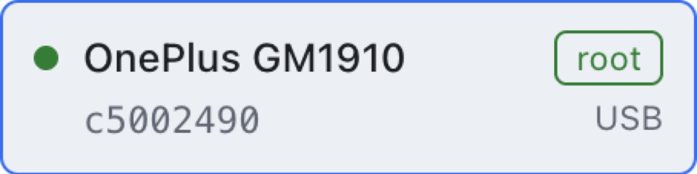

*图 8-6　进入 root 后，设备列表中显示绿色的 root 标记*

### 8.7 root 终端

右键选「打开 root 终端」，会新开一个 Shell 标签，并按设备配置的方式自动完成 su。整个过程直接显示在终端里，密码不会回显：

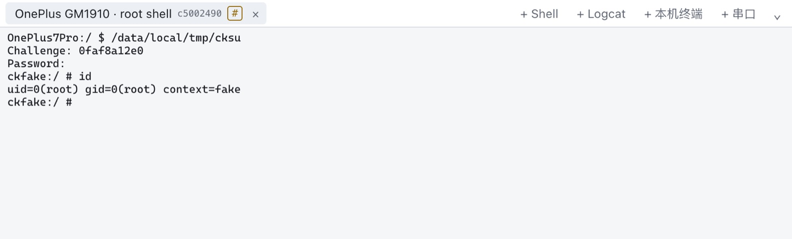

*图 8-7　root 终端自动完成挑战码认证，标签名为「root shell」，身份标记为 `#`（图中为演示用的模拟 su）*

如果失败，终端里会用红字写明原因，标签保留为普通 shell。点「重新连接」时会再次自动进入 root。

### 8.8 失败时的提示

进入失败时，提示会说明卡在哪一步，并附上 su 最后的输出，便于排查：

| 提示 | 原因与处理 |
|---|---|
| su 执行失败（su 输出：… not found） | 设备上没有 su，或「su 命令」路径不对 |
| su 要求输入密码：请在 root 方式里改用「密码」或「解密工具」 | 当前是「su（免密）」方式，但设备的 su 需要密码 |
| su 要求输入密码，但还没有保存密码 | 「用户名 + 密码」方式下没有保存密码 |
| su 再次要求输入密码：保存的密码不对 | 密码错误，请在设置中重新填写 |
| su 再次要求输入密码：解密工具算出的密码不对 | 解密工具的版本或算法与设备不匹配，或挑战码识别有误，可以填写「提取挑战码的正则」 |
| 没能从 su 的输出里找到挑战码 | 自动识别失败，请填写「提取挑战码的正则」 |
| 解密工具运行失败：找不到这个文件 | 工具路径错误 |
| 解密工具运行失败：20 秒内没有结束 | 工具需要图形界面操作，或在等待键盘输入（可尝试勾选“写到标准输入”） |
| 该设备不支持 adb root | user 版本的 adbd 不能以 root 运行，请改用其它方式 |
| 等待 su 响应超时（15 秒） | su 没有任何反应，例如在等待手机上的授权弹窗 |

---

## 9. 文件传输

在右侧设备信息里点「文件传输」，或把文件拖到投屏画面、设备信息区域上，打开文件传输窗口。

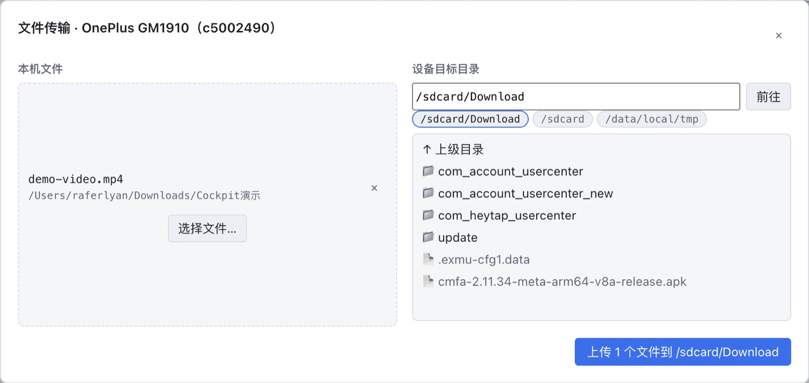

*图 9-1　左侧是本机文件，右侧是设备目标目录*

### 9.1 上传文件

1. **选择本机文件**：把文件拖到左侧区域，或点「选择文件…」。每个文件显示两行：第一行是文件名，第二行是所在目录。路径很长时会省略目录的开头，保留离文件最近的几级，不会挤压右侧的目标目录；鼠标悬停可以看到完整路径。点 × 移除。
2. **选择设备目录**，三种方式：
   - 在输入框里填写路径，点「前往」；
   - 点快捷目录 `/sdcard/Download`、`/sdcard`、`/data/local/tmp`；
   - 在下方列表中点文件夹逐级进入，点「↑ 上级目录」返回。
3. 点「上传 N 个文件到 …」。

目录不存在时会自动创建。单个文件失败不影响其它文件，每个文件的结果列在窗口底部。上次使用的设备目录会被记住。

### 9.2 进度显示

点击上传后，窗口底部立即出现进度区，依次显示以下阶段，并始终显示已用时间：

| 阶段 | 显示 |
|---|---|
| 检查目标目录 | 「正在检查目标目录（是否可写、分区是否只读）…」，滚动条表示正在进行 |
| 获取 root（需要时） | 「目标目录需要 root，正在获取 root 权限…设备上弹出授权时请点允许」 |
| 传输数据 | 百分比、已传 / 总量、速度、剩余时间；多个文件时显示当前是第几个 |
| 用 root 写入（需要时） | 「已传到设备临时目录，正在用 root 写入目标位置…」 |
| 上传目录 | 「正在上传目录（adb push 不提供进度）…」 |

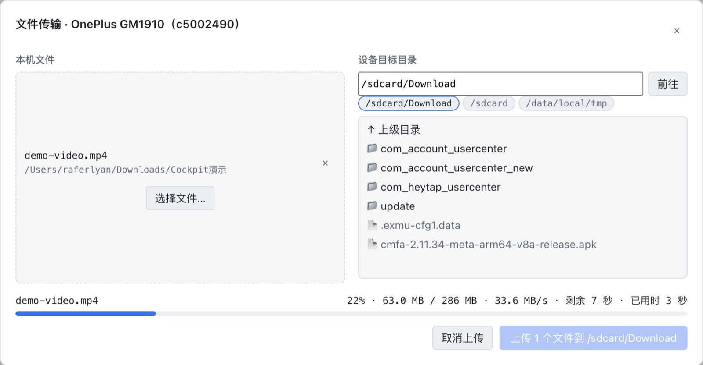

*图 9-2　传输阶段显示百分比、速度和剩余时间*

**随时可以取消**：点「取消上传」，或点右上角 × 关闭窗口（关闭前会确认，关闭即取消）。以下情况也会自动中止，写了一半的文件会被删除：

- 设备 30 秒不接收数据；
- 数据发完后 2 分钟内设备没有确认写入；
- 设备断开连接。

### 9.3 上传失败的原因与处理

Cockpit 在**发送数据之前**就会检查目标目录：能否写入、所在分区是否只读挂载、adbd 是否是 root、能否拿到 root。写不进去时立即说明原因，不会先把整个文件传完才报错。失败原因会常驻显示在窗口里，下方的结果列表也会逐个文件列出。

**情况一：分区只读，也拿不到 root**

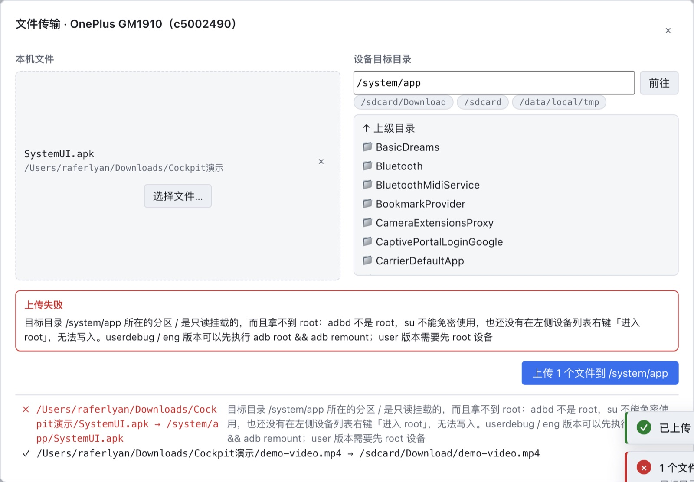

*图 9-3　说明分区只读、设备也没有 root，并分别给出 userdebug 和 user 版本的处理办法*

处理办法：

- userdebug / eng 版本：执行 `adb root && adb remount`，或在 Cockpit 中右键选「临时换一种方式 → adb root」后重试。
- user 版本：需要先 root 设备，或在 root 方式中配置密码或解密工具后进入 root。

**情况二：分区只读，但已经能拿到 root**

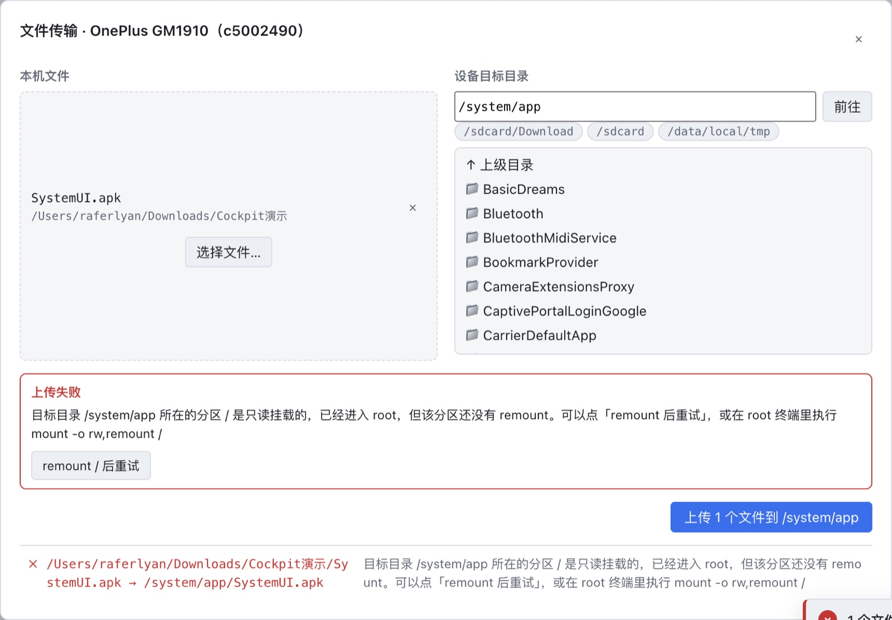

*图 9-4　已进入 root 时，提供「remount / 后重试」按钮*

点「remount 〈挂载点〉 后重试」，Cockpit 会把该分区重新挂载为可写，然后自动重新上传：

- adbd 是 root 时，执行 `adb remount`（会自动处理 overlayfs）；
- 通过 su 进入 root 时，执行 `mount -o rw,remount 〈挂载点〉`。

如果 remount 失败（设备启用了 dm-verity 或使用动态分区），提示会说明需要先执行 `adb root && adb disable-verity`，重启设备后再 `adb root && adb remount`。如果 `adb remount` 提示需要重启，按提示重启设备后再试。

**情况三：分区可写，但没有权限，也没有 root**

例如上传到 `/data/app`。提示会建议进入 root，或改传到 `/sdcard`、`/data/local/tmp` 这类普通目录。

**已有 root 时的写入方式**

往受保护的目录上传时，Cockpit 会先以普通身份把文件传到 `/data/local/tmp`，再用 root 复制到目标位置，这样文件能继承目标目录的 SELinux 上下文。替换正在运行的 APK（如 SystemUI）时，会先复制为临时文件再改名替换，不会先删除正在使用的旧文件。

### 9.4 从设备下载

在右侧目录列表中，把鼠标移到文件或文件夹上，点「下载」，选择电脑上的保存目录即可。完成后可以在结果列表里点「打开所在目录」。没有读取权限的文件，在已进入 root 时会自动经 root 读取。

---

## 10. 应用管理

点右侧「应用管理」，扫描设备上的全部应用：

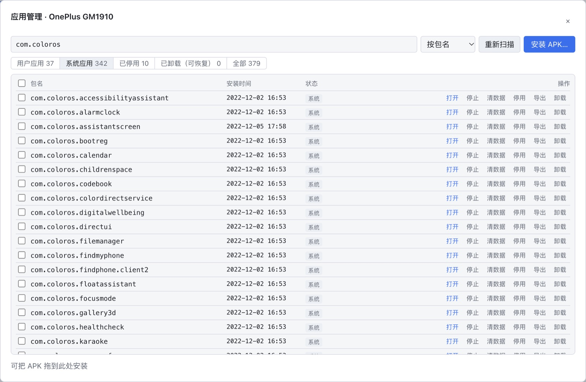

*图 10-1　应用管理窗口，图中为搜索 `com.coloros` 后的系统应用列表*

- **分类**：用户应用、系统应用、已停用、已卸载（可恢复）、全部，标签上显示各类数量。
- **搜索**：按包名过滤。
- **排序**：按包名、按安装时间、按更新时间。列表显示首次安装时间，更新过的应用还显示最近更新时间。
- **单个应用的操作**：
  - 打开：拉到前台；已在运行就直接切回。
  - 停止：强制停止。
  - 清数据：清除全部数据，操作前会确认。
  - 停用 / 启用。
  - 导出：把 APK 保存到电脑。
  - 卸载：系统应用只对当前用户卸载，可以在「已卸载（可恢复）」中恢复。
- **批量操作**：勾选多个应用后，可以「卸载所选」「停用所选」「恢复所选」。
- **安装**：点「安装 APK…」，或把 APK 拖到窗口里。
- **重新扫描**：重新读取应用列表。

> **注意**：卸载或停用关键系统组件可能导致设备异常，操作前请确认清楚它的用途。

---

## 11. 截图与标注

点右侧「截图」（或投屏工具栏的「截图」），按设备原始分辨率截图，先弹出预览：

- **保存**：存到「图片/Cockpit」目录，同时复制到剪贴板；
- **另存为…**：自己选择保存位置和文件名；
- **编辑标注**：进入标注模式。

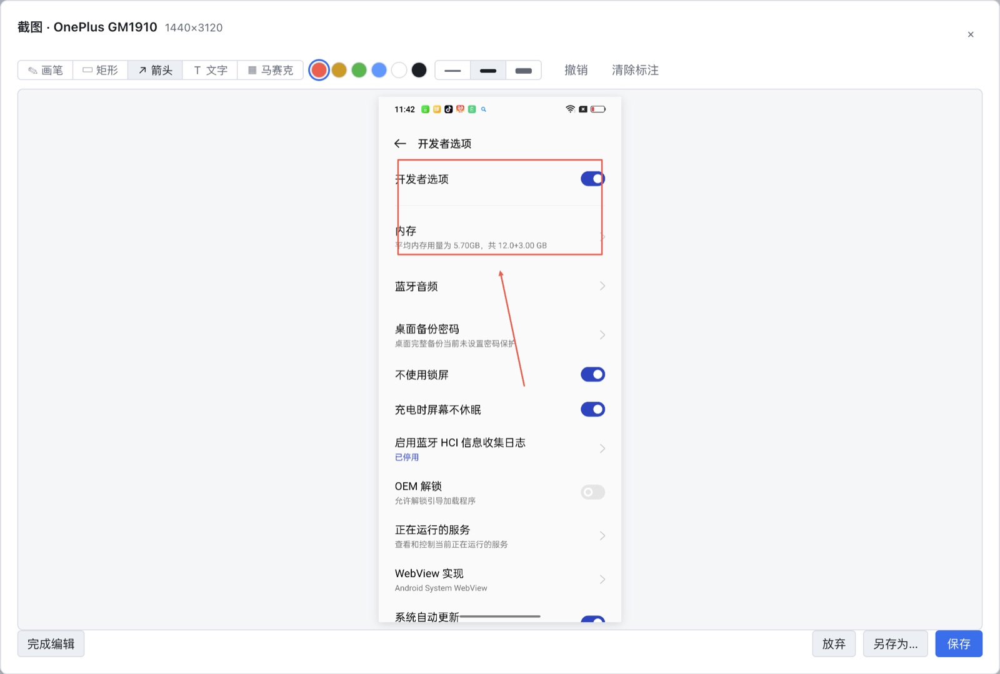

*图 11-1　标注模式，图中用矩形和箭头做了标注*

| 工具 | 用法 |
|---|---|
| 画笔 | 自由绘制 |
| 矩形 | 拖动画框 |
| 箭头 | 从起点拖到箭头指向的位置 |
| 文字 | 点击位置后输入文字 |
| 马赛克 | 拖动遮盖区域，用于隐藏敏感信息 |
| 颜色 / 粗细 | 6 种颜色，3 种粗细 |
| 撤销 / 清除标注 | 撤销上一步（⌘Z / Ctrl+Z），或清除全部标注 |

标注完成后点「完成编辑」回到预览，也可以直接「保存」。点「放弃」丢弃这次截图。保存后窗口不会自动关闭，会显示完整路径，可以「复制路径」或「打开所在目录」。

---

## 12. 导出设备日志

点右侧「导出日志」，批量导出设备上的日志文件：

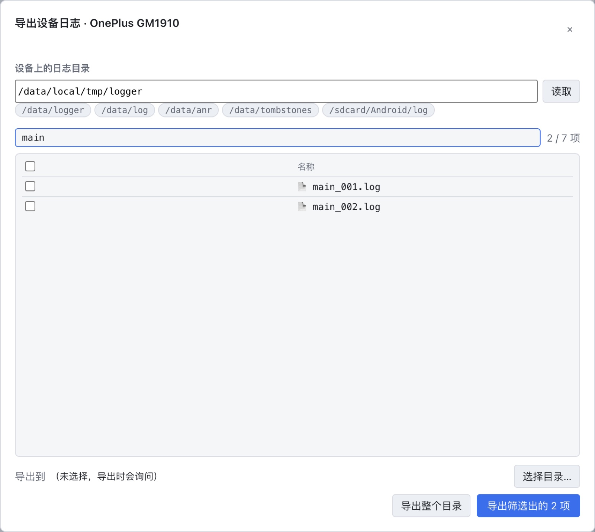

*图 12-1　读取日志目录，按文件名筛选后导出*

1. **选择目录**：默认读取 `/data/logger`；也可以点 `/data/log`、`/data/anr`、`/data/tombstones`、`/sdcard/Android/log` 快捷目录，或填写其它路径后点「读取」。
2. **筛选**：按文件名筛选，空格分隔多个关键词时，**文件名需要包含全部关键词**；支持 `*`、`?` 通配。右侧显示「匹配数 / 总数」。
3. **勾选**：勾选部分文件；不勾选时导出全部匹配的文件。
4. **导出位置**：点「选择目录…」预先选好；不选时导出时再询问。
5. **导出**：点「导出全部 N 项」（有筛选时为「导出筛选出的 N 项」），或点「导出整个目录」。

需要 root 才能读取的目录，在已进入 root 或设备有免密 su 时会自动经 root 读取。

---

## 13. 录制与分析 Trace（Perfetto）

### 13.1 录制

点右侧「录制 Trace」，用设备自带的 perfetto 录制系统 trace（需要 Android 10 及以上），手机上不需要安装任何东西。

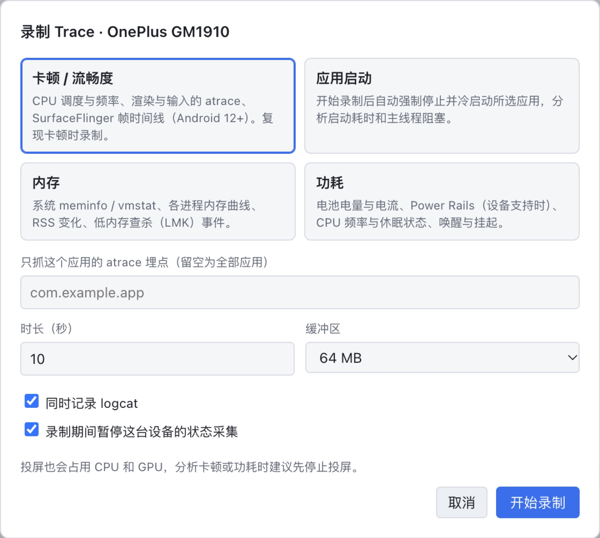

*图 13-1　选择预设并设置录制参数*

| 预设 | 录制内容 | 适合分析 |
|---|---|---|
| 卡顿 / 流畅度 | CPU 调度与频率、渲染和输入相关的 atrace、SurfaceFlinger 帧时间线（Android 12+） | 卡顿、掉帧 |
| 应用启动 | 同上；开始录制后自动强制停止并冷启动所选应用 | 启动耗时、主线程阻塞 |
| 内存 | 系统 meminfo / vmstat、各进程内存曲线、RSS 变化、低内存查杀（LMK）事件 | 内存上涨、后台被杀 |
| 功耗 | 电池电量与电流、Power Rails（设备支持时）、CPU 频率与休眠状态、唤醒与挂起 | 耗电、发热 |

| 选项 | 说明 |
|---|---|
| 只抓这个应用的 atrace 埋点 | 填写包名；留空为全部应用 |
| 时长（秒） | 默认 10 秒 |
| 缓冲区 | 默认 64 MB；时长较长或事件较多时调大 |
| 同时记录 logcat | 把 logcat 一起写进 trace |
| 录制期间暂停这台设备的状态采集 | 默认勾选，避免 Cockpit 自己执行的 shell 命令出现在 trace 里 |

点「开始录制」后显示录制进度：


*图 13-2　录制进度。可以「后台继续」关掉窗口，或提前「结束录制」*

- 「结束录制」会提前结束，已录到的部分照常保存。
- 「后台继续」关闭窗口，录制在后台继续进行。

### 13.2 在 Perfetto 中分析

录制完成后，trace 自动保存到「文稿/Cockpit/Traces」，并在中间区域内嵌的 Perfetto 中打开，直接缩放到实际录制的时间段：

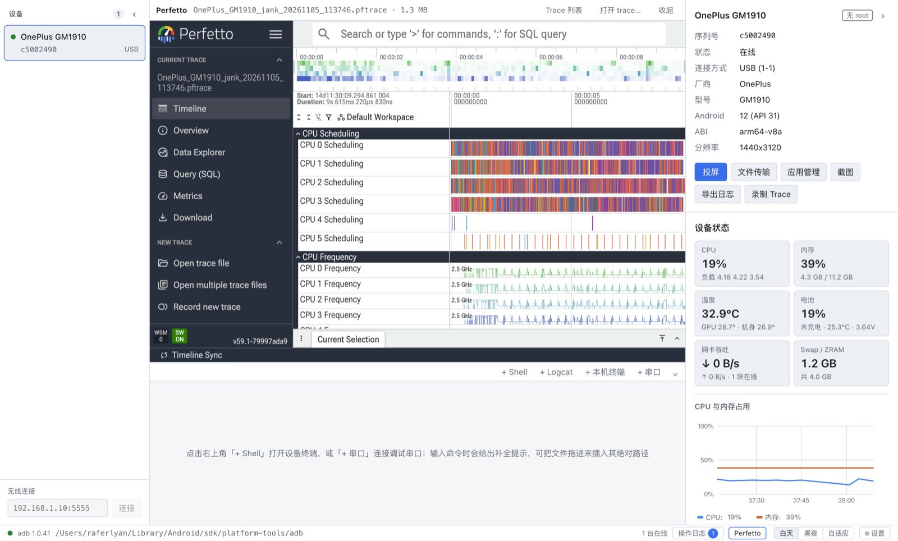

*图 13-3　内嵌的 Perfetto，可以查看 CPU 调度、频率、线程状态、帧时间线，并支持 SQL 查询*

Perfetto 区域顶部的工具栏：

| 按钮 | 作用 |
|---|---|
| Trace 列表 | 录过的 trace 文件，可以重新打开、在 Finder / 资源管理器中显示，或移到废纸篓 |
| 打开 trace… | 打开电脑上已有的 `.pftrace`、`.perfetto-trace`、systrace、JSON 等 trace 文件 |
| 收起 | 关闭查看器并释放占用的内存 |

随时可以点底部状态栏的「Perfetto」打开查看器。Perfetto 界面随应用一起打包，**完全离线运行，trace 不会上传到任何地方**。

---

## 14. 操作日志

点底部状态栏的「操作日志」，右侧会滑出操作日志面板。面板关着时有新操作，按钮上会显示新增的条数。

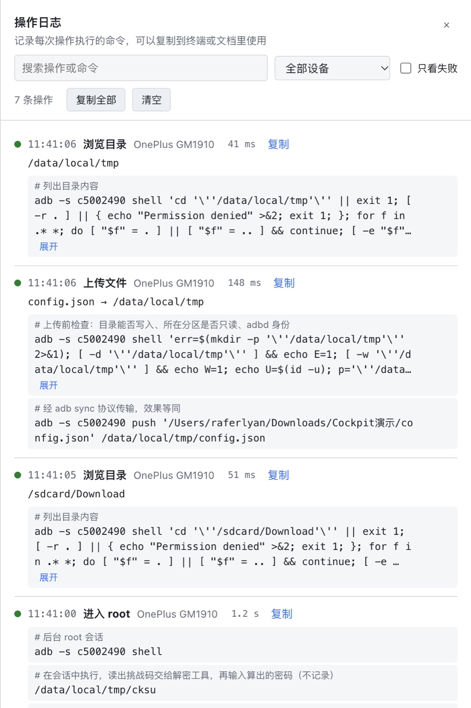

*图 14-1　操作日志。每条记录是一次操作，下面列出它执行的命令，`#` 开头的灰字说明命令的用途*

**会记录哪些操作**

无线连接与断开、开始 / 停止投屏、打开 Shell / Logcat / 本机终端 / root 终端、浏览目录、上传、下载、remount、统计目录占用、进入 / 退出 root、扫描应用、打开 / 停止 / 卸载 / 恢复 / 停用 / 启用应用、清除数据、导出和安装 APK、截图、录制 Trace。

每条记录显示时间、操作名称、设备、耗时和结果（绿点成功、红点失败、闪烁表示进行中）。失败时会显示失败原因，包括部分文件上传失败的情况。

**命令的内容**

- 操作期间执行的每条 adb 命令都会列出，例如 `adb -s c5002490 exec-out screencap -p`。参数已按 shell 规则加好引号，复制出去可以直接在终端里执行。
- 经 sync 协议上传的文件，会给出效果相同的 `adb push` 命令。
- 进入 root 后在 root 会话里执行的命令，标注为「root 会话中执行」；调用本机解密工具的命令行也会列出。
- 内部使用的检查脚本（如上传前检查目标目录）比较长，默认只显示三行，点「展开」查看全文。
- **密码不会被记录**：su 时自动输入的密码直接写进终端，不经过命令记录。
- 后台每秒执行的状态采集、包名补全等命令不会记录，日志里只有用户的操作。

**复制与筛选**

| 操作 | 方法 |
|---|---|
| 复制一条命令 | 鼠标移到命令上，点右侧的「复制」 |
| 复制一次操作的全部命令 | 点操作标题行右侧的「复制」 |
| 复制全部 | 点顶部「复制全部」，按时间顺序复制当前筛选出的所有操作 |
| 搜索 | 按操作名称、说明或命令内容搜索，空格分隔多个关键词时需要全部包含 |
| 按设备筛选 | 下拉选择某台设备，已断开的设备也能选 |
| 只看失败 | 勾选后只显示失败的操作 |
| 清空 | 清除全部记录 |

复制的文本里，操作名称、设备、说明和失败原因都写成 `#` 开头的注释，可以直接粘贴到终端、脚本或文档中，例如：

```bash
# 2026/11/5 11:31:10 上传文件 (OnePlus GM1910) · demo.apk → /sdcard/Download
# 上传前检查：目录能否写入、所在分区是否只读、adbd 身份
adb -s c5002490 shell 'err=$(mkdir -p ...'
# 经 adb sync 协议传输，效果等同
adb -s c5002490 push /Users/me/Downloads/demo.apk /sdcard/Download/demo.apk
```

操作日志最多保留最近 300 条操作，关闭应用后清空。按 Esc 或点面板外的区域关闭面板。

---

## 15. 设置与个性化

点底部状态栏右侧的「设置」：

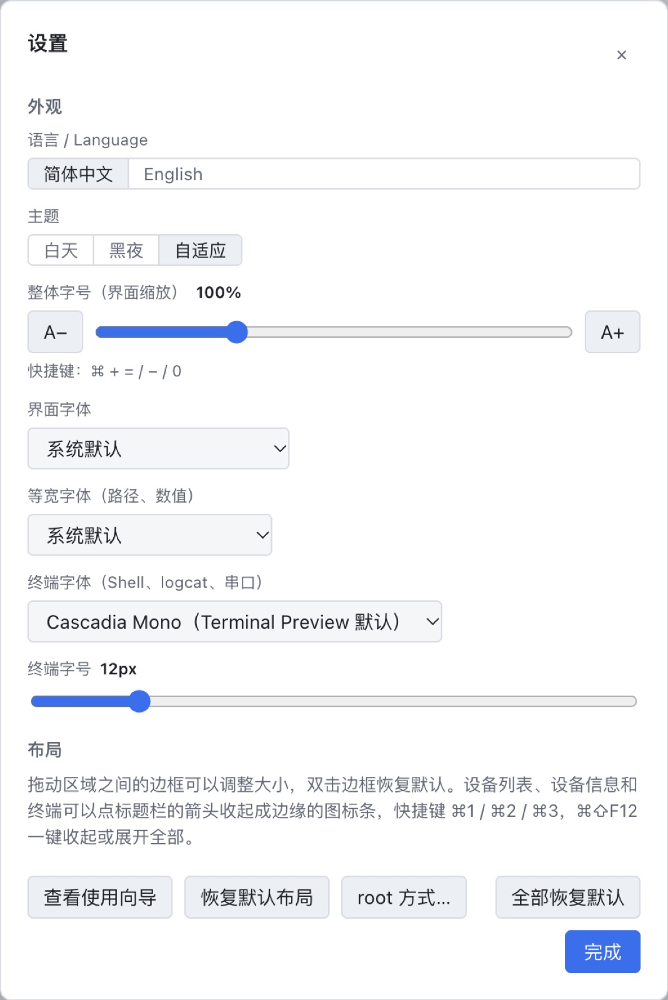

*图 15-1　设置窗口*

| 设置项 | 说明 |
|---|---|
| 语言 / Language | 简体中文或 English，立即生效，不会中断投屏和终端 |
| 主题 | 白天、黑夜，或自适应（跟随系统深浅色）；状态栏右侧也能切换 |
| 整体字号（界面缩放） | 80%～150%，字号和间距一起缩放 |
| 界面字体 | 预设或自定义字体名 |
| 等宽字体 | 用于路径、数值等 |
| 终端字体 / 终端字号 | Shell、Logcat、串口的字体和字号 |
| 布局 | 「恢复默认布局」恢复各区域大小和收起状态 |
| 查看使用向导 | 重新打开使用向导 |
| root 方式… | 打开 root 方式设置（见 8.4） |
| 全部恢复默认 | 恢复以上所有设置 |

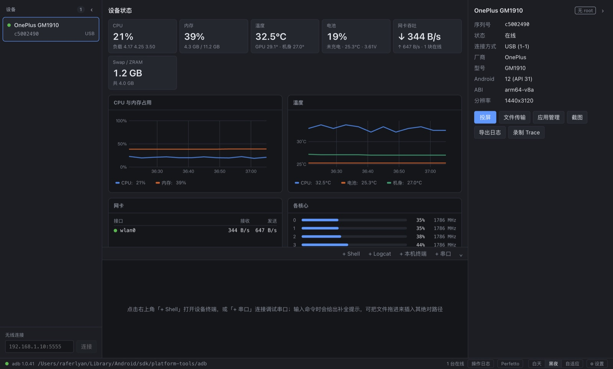

*图 15-2　深色主题*

---

## 16. 常见问题

**设备列表是空的**
检查底部状态栏是否找到了 adb，手机上是否允许了 USB 调试，数据线是否支持数据传输。可以在本机终端里执行 `adb devices` 确认。

**设备显示“未授权”**
在手机上确认 USB 调试授权弹窗。没有弹窗时，在开发者选项里「撤销 USB 调试授权」，然后重新插拔。

**投屏黑屏或没有画面**
设备可能息屏了，点工具栏的「电源」点亮。目前只支持 H.264 编码。

**在 Shell 里 su 后，上传到 `/system` 还是提示只读**
su 只让那一个终端变成 root，而且 `/system` 是只读挂载的，需要 remount。右键设备「进入 root」后再上传，按提示点「remount 后重试」。详见 [8.1](#81-先分清-root-和-remount) 和 [9.3](#93-上传失败的原因与处理)。

**remount 失败**
设备启用了 dm-verity 或使用动态分区时，单纯 `mount -o rw,remount` 改不了。需要 userdebug 版本：`adb root && adb disable-verity`，重启后 `adb root && adb remount`。

**上传到 `/data/...` 失败**
普通 adb 身份没有写权限。进入 root 后重试，或改传到 `/sdcard`、`/data/local/tmp`。

**进入 root 时一直等待然后超时**
手机上可能弹出了 root 授权框（Magisk、KernelSU 等），请在手机上点允许。

**想知道某个操作具体执行了哪些命令**
打开状态栏的「操作日志」，找到对应的操作即可查看和复制，详见第 14 章。

**解密工具在命令行里能用，Cockpit 里却超时**
确认工具不需要按键确认或图形界面操作。如果工具从键盘读取挑战码，请勾选「同时把挑战码写到工具的标准输入」。

**没有包名提示**
包名在第一次需要时在后台读取（`pm list packages`），稍等一两秒再输入即可。

**录制 Trace 按钮不可用**
录制需要 Android 10 及以上版本，鼠标悬停在按钮上会显示原因。

---

## 17. 附录

### 17.1 快捷键一览

| 功能 | macOS | Windows |
|---|---|---|
| 收起 / 展开设备列表 | ⌘1 | Ctrl+1 |
| 收起 / 展开设备信息 | ⌘2 | Ctrl+2 |
| 收起 / 展开终端 | ⌘3 | Ctrl+3 |
| 一键收起 / 展开全部 | ⌘⇧F12 | Ctrl+Shift+F12 |
| 放大 / 缩小 / 还原界面 | ⌘= / ⌘− / ⌘0 | Ctrl+= / Ctrl+− / Ctrl+0 |
| 终端复制 | ⌘C | Ctrl+Shift+C（有选中时 Ctrl+C） |
| 终端粘贴 | ⌘V | Ctrl+V / Ctrl+Shift+V |
| 采用补全候选 | Tab 或 → | Tab 或 → |
| 关闭补全提示 / 对话框 / 操作日志 | Esc | Esc |
| 截图标注撤销 | ⌘Z | Ctrl+Z |

### 17.2 文件保存位置

| 内容 | 位置 |
|---|---|
| 截图 | 「图片/Cockpit」（macOS：`~/Pictures/Cockpit`；Windows：`图片\Cockpit`） |
| Trace | 「文稿/Cockpit/Traces」（macOS：`~/Documents/Cockpit/Traces`；Windows：`文档\Cockpit\Traces`） |
| root 方式设置 | 应用数据目录下的 `root-settings.json`，其中的密码已加密 |

### 17.3 数据与隐私

- Cockpit 只通过本机的 adb 与设备通信，手机上不安装任何程序。
- root 密码用系统钥匙串加密后保存在本机，不会上传，界面上也不会显示明文。
- Perfetto 查看器随应用打包，完全离线运行，trace 文件不会离开你的电脑。
- 解密工具在本机运行，Cockpit 只把挑战码传给它、读取它输出的密码。
- 操作日志只保存在内存里，关闭应用即清空；su 密码不会出现在日志中。
